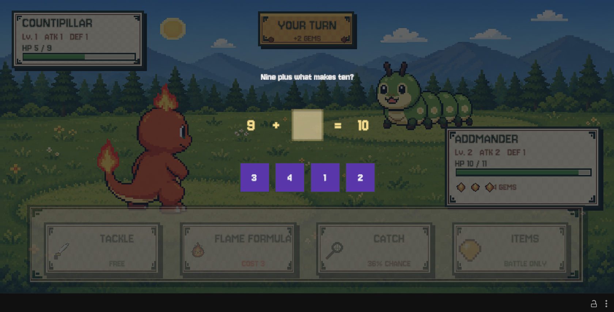
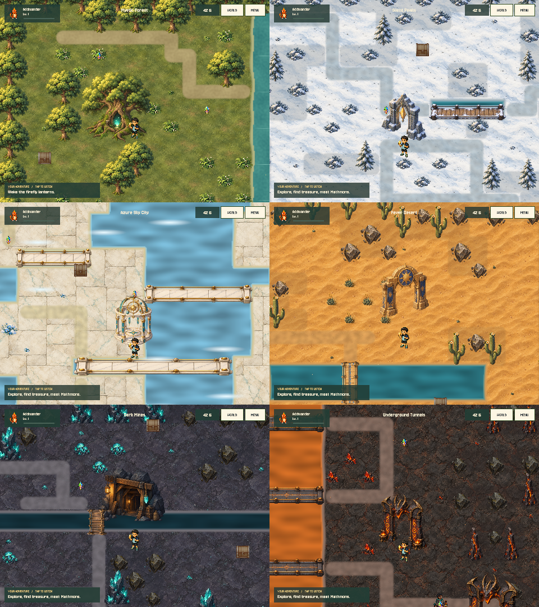
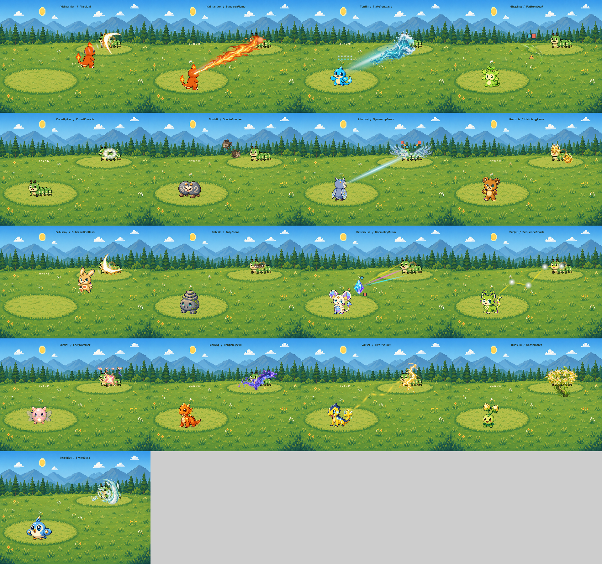

# Numeria 🔢✨

**A Pokémon-inspired math RPG built for a five-year-old.** In Numeria, numbers, shapes, symmetry, and patterns
are magic. Players befriend original creatures called **Mathmons**, solve adjustable K–5 math puzzles to power
their skills, and help Lucas restore six Digit Crystals so he can reopen the legendary gate home.

> Current development: eight main worlds plus eight optional depths, a lifetime collection guide, and
> **247 Mathmon forms / 142 families** (159 existing forms + 80 new ordinary species + 8 giants; Mega not counted).
> The installed iPad build still has 159 forms. This expansion stays local until a save-safe device update;
> **Lucas's iPad save is authoritative**.



## Current development status

| Milestone | Status | What is available |
|---|---|---|
| P0 — Project foundation | ✅ Complete | Repository, Unity project, asset pipelines |
| P1 — Battle core | ✅ Complete | Skills, gems, number shields, ATK/DEF combat, VFX, narration |
| P2 — Forest vertical slice | ✅ Complete | Exploration, encounters, catching, growth, chests, saving |
| P3 — Full game systems | 🔶 Playable / polishing | Eight main worlds + eight optional depths, 247 forms, collection guide, evolution, economy, Lucas story |
| P4 — iOS delivery | 🔶 On-device / polishing | Signed iPad build and transferred progress confirmed playable; ongoing device QA and save-safe updates |

The local expansion passes **204/204 Unity EditMode tests** plus **15/15 Node prototype tests**;
coverage and remaining device checks are tracked in [Eight Depths](docs/eight-depths.md).
Local saves now use **schema v13**, adding collection and giant-reward history without resetting previous fields.
The installed release uses **schema v12**. Version **1.3.1 (5)**
was installed in place on the iPad on September 22. All four saved files matched the fresh device backup
byte-for-byte before launch. The app launched; user verification of loading, visuals and audio remains pending.

### Local expansion — Field Guide and Eight Depths (not installed)

MENU → DEX lists every form, with unknown pictures/names hidden, introductions and offline narration,
collection filters and stable pagination. Catching and evolution permanently register a form; releasing a
partner does not erase its record. Older saves seed only the current owned forms they can prove, not invented history.

Each main-world guardian unlocks a nearby portal into a new layer: Verdant Vault, Rime Gallery, Zephyr Gardens,
Dusk Oasis, Resonant Foundry, Ember Reservoir, Chronicle Archive and Moonwell Depths. Every layer contains ten
ordinary species, three untimed environmental mechanisms and one fixed-level giant challenge. Winning befriends
the giant directly; a full 99-partner team can claim it later through DEX. Return portals are always available.
These 88 new species are single-stage; their separate Mega designs are deferred. Existing 159 Mega forms remain unchanged.
See [the full roster, access rules, safeguards and validation](docs/eight-depths.md).

### Installed update — trainers, safer team management and K–5 learning

Installed in 1.3.1 (5): battle skills now rotate through the full grade pool instead of
forcing one family 75% of the time. Balance questions control zero frequency and add six Challenging
equation templates. Master encounters use a 30% base chance with a guarantee after four ordinary
encounters. See [behavior, tests and remaining device checks](docs/battle-variety.md).

The **1.3.0** curriculum expansion introduced explicit grade inventories: 17/19/18/20/22/24 mixed
task families for K/Grades 1–5, with interactive number bonds and ordered paths, balanced equations, visual
patterns in every grade, stories, arrays, money, fractions, conversions and coordinates. A shuffle bag
reduces repeated families; charts no longer disclose the quantities being tested. See the
[actual coverage, limits and validation](docs/curriculum-expansion.md). Installed in place with all four save files verified unchanged.

Lucas now appears behind his battle partner. Random Master encounters use 20 new trainer portraits and
20–40% nominal stat bonuses; fixed Boss levels are unchanged. Battle adds **Defend** (half damage for the next
enemy attack) and new Tackle art. TEAM adds sorting, two-stage Let Go confirmation, and explicit equipment
transfer between partners. SYSTEM selects K–5 and four difficulty modes, progressing linearly across chapters
inside the chosen grade/mode. Five new math families add place value, time, fractions, measurement and data.
See [rules, previews, tests and save/rollback safety](docs/training-and-learning.md).

TEAM keeps its scroll position when selecting partners or refreshing details, with safe clamping after
removal. This tested fix is included in the installed 1.3.0 (4) build.

### Afterstory expansion — installed on iPad

Ancient Ruins and Veilmoon Lake add six evolution families, six skill choreographies, math-restored crossings,
new battle paintings and fixed Lv.58/Lv.66 Bosses. They unlock after the six-crystal story and award two separate
badges. See [expansion details, save compatibility and iPad acceptance](docs/afterstory-expansion.md).
Version 1.1.0 (2) was installed in place on September 13. All four saved files matched the fresh device backup
byte-for-byte before first launch; user gameplay acceptance is pending. Always back up the iPad before updating.

### World and skill presentation — full-roster rollout

All eight regions now use character-scale environment rendering with distinct ground, vegetation, landmarks,
bridges and atmospheric accents: woodland, snow, floating marble ruins, desert, crystal mines and lava tunnels.
The afterstory adds an ivory mosaic observatory and a lantern-lit moon lake with puzzle-restored crossings.
The existing gameplay layouts and saved progress are retained. Forest keeps its puzzle-restored vine bridge and
three-discovery guardian unlock; other regions gain visible restoration accents around solved discoveries.

All **23 skill visual kinds** have authored 1.9-second timelines, reused across **247 forms / 142 families**, Tackle,
normal math skills, supported Mega skills and enemy attacks. Evolution and Mega add scale and resonance; related creatures
share choreography, rather than having 247 individually animated moves. Actual puzzle numbers/shapes feed the
spell where relevant. See [coverage, verification and remaining limitations](docs/world-presentation.md).

Silent Peaks also has a new snow-and-glacier battle panorama, replacing its separate legacy placeholder;
see [battle-background correction and aspect-ratio previews](docs/silent-peaks-battle.md).
All eight battle scenes now preserve background proportions and use scene-specific grounded actor placement.
Forest and underground have new biome-matched paintings; desert platforms are repositioned while preserving
their original art direction. See [battle-stage correction and generated assets](docs/battle-background-alignment.md).





## Design principles

- **Math is magic, not a test.** Problems appear as spells, crystal patterns, treasure locks, and world runes.
- **Zero punishment for mistakes.** A wrong answer never damages the player. Skills still use their base power,
  and the game provides another visual explanation or retry.
- **Understandable without fluent reading.** Questions, story dialogue, catches, evolution, shops, and feedback
  use pre-baked English narration rather than online text-to-speech.
- **Small, child-readable numbers.** HP, gems, damage, coin rewards, prices, and puzzle answers stay within
  intentionally understandable ranges.
- **Original world and creatures.** Numeria takes structural inspiration from creature-collection RPGs but uses
  original Mathmons, characters, artwork, skills, progression, and fiction.

## Implemented gameplay

### Battle and Mathmons

- 247 Mathmon forms across 142 families, with independent level, XP, HP, ATK, and DEF growth to Lv. 99.
  The optional depths add 88 independent single-stage species to the previous 159 forms / 54 families.
  Six new three-stage afterstory families bring mosaics, abacus bears, clockwork birds, lantern fish, moon foxes and lotus turtles.
- The original eleven families retain distinct skills, while each new elemental group has its own generated icon,
  palette, and battle performance.
- Number shields, shield-break stun, gems, powered math skills, consumable items, and equippable accessories.
- The 159 original Mathmon forms can Mega Evolve after reaching 7 Gems and solving a tier-appropriate math puzzle. All 159
  forms have their own redesigned Mega sprite—not a scaled normal sprite or generic aura/wing overlay—plus a stable
  species-specific 25–35% base-stat boost and a free Nova skill. All skills are free while transformed; one Gem
  drains after every action, Gem Snacks are sealed, and the form ends at zero Gems. Gems can then be rebuilt for
  another activation in the same battle.
- Every shield break independently arms one clearly labeled **2× next hit** bonus, including second and later cycles.
- Damage uses `max(1, ATK - DEF + 1 + [-1, 1])`; enemy HP also has controlled per-encounter variation.
- Story Bosses have fixed chapter levels **5 / 12 / 20 / 32 / 42 / 50**, number shields, and tuned HP/ATK/DEF;
  training no longer raises their stats. Wild encounters have chapter-specific level ranges and merchants have fixed
  levels. See [chapter balance](docs/chapter-balance.md) for exact values, simulation assumptions and save safety.

### Catching and team management

- Catch can be attempted at any remaining HP.
- Success follows a health-based curve from roughly **10% at full HP to 95% near zero HP**.
- The traveling team holds at most **99 Mathmons**.
- If a catch would exceed the limit, the player chooses whether to release the newcomer or replace an existing
  companion. Addmander remains the protected starter, and released companions return equipped accessories.
- Any non-starter companion can also be released from TEAM for either coins or Battle Buddy XP. Rewards rise at
  every level: `coins = level + 2`, `XP = level x 2 + 4`; equipped accessories always return to ITEMS.
- A caught Mathmon keeps its wild level, evolution form, and exact battle HP/ATK/DEF. Individual stat offsets
  remain attached through later growth and saves. When a stronger member of an owned family is caught, the player
  chooses between adopting it or converting the catch into **125% of the normal catch XP**.

### Exploration and economy

- All eight regions use `WorldScene` and generated painted environments; Mystic Forest delegates its authored
  events to `ForestScene`. Terrain surfaces, row-sorted props, cardinal bridges, landmarks and lightweight
  atmospheric drift share the existing semantic gameplay grid. Water, cliffs, treasure and exits retain their
  gameplay meaning. The WORLD atlas uses the same region landmarks. Older third-party tile renderers are retained
  for reference, but no longer draw the main exploration scenes.
- Four visible math-discovery runes per map. Solving their themed puzzle awards one-time coins and occasional
  battle items; incorrect answers leave the discovery available for another attempt.
- Ordinary enemies, merchant challenges, and bosses award region-scaled coins.
- Every region has an original merchant character. Defeat their trained Mathmon to unlock a permanent shop with
  limited quantities of consumables, balanced accessories, and evolution stones.
- Treasure chests, weighted regional ecosystems, item drops, evolution trials, and three-part portal trials.

### Story and presentation

- A title screen with **Start a New Game** and **Load Game**, ten-slot selection, overwrite confirmation, and a
  narrated introduction starring Lucas and Addmander.
- Lucas explores Numeria while the selected Mathmon remains the active battle companion.
- Elder Rowan, Keeper Orin, Astronomer Lyra, Sage Solara, Engineer Vesper, and Keeper Echo guard the six Digit Crystals.
- Guardian conversations appear before and after each boss, leading to a six-crystal ending while leaving free
  exploration available.
- TEAM, ITEMS, RECORDS, SAVES, and SYSTEM menus; ten independent save slots and a save-aware return-to-menu flow.
- Unified TextMeshPro/Jersey 10 typography, generated pixel-art characters and icons, ten SFX cues, and nine
  mood-based 8-bit music tracks with crossfading and narration ducking.

## Grade-based math progression

Choose **Kindergarten or Grade 1–5** in SYSTEM, then **Normal / Feel Good / Challenging / Random**.
Each grade remembers its own mode. Chapters 1–8 linearly raise the allowed difficulty inside that selection,
never automatically crossing into the next grade. Kindergarten arithmetic stays within 10; Grade 1 stays
within 20. Later grades add multi-digit work, multiplication/division, fractions, decimals and measurement.
Visual patterns and symmetry remain alongside the five new families. Mistakes still receive hints and a retry.
This is a curated practice set, not a complete K–5 curriculum; see the [grade table and exact rules](docs/training-and-learning.md).

## Run the Unity game

Requirements:

- Unity **6000.5.6f1**
- Unity Input System and TextMeshPro packages restored by the project
- macOS, Windows, or another Unity Editor-supported development host

Steps:

1. Open the [`unity/`](unity/) directory as a Unity project.
2. Open `Assets/Scenes/SampleScene.unity`.
3. Press **Play**. `BattleBootstrap` constructs the map and UI at runtime; the scene intentionally contains no
   hand-authored gameplay hierarchy.

### Install the licensed 8-bit soundtrack

The licensed **The 8-bit Jukebox Lite** source package and synchronized runtime WAVs are intentionally excluded
from Git. After importing the package at
`unity/Assets/Cyberleaf Music - The 8-bit Jukebox Lite`, run:

```bash
zsh tools/install-jukebox-music.sh
```

The installer maps nine local tracks to region, battle, boss, and evolution moods; the two afterstory regions
reuse Sky/Mountains moods. Attribution and
the exact track list are documented in [`docs/music-attribution.md`](docs/music-attribution.md).

### Map art and preview tools

The current eight-region presentation uses committed generated resources under
`unity/Assets/Resources/generated/Exploration`. No Asset Store download is needed for these new environment
layers. See [asset provenance and exact generation prompts](docs/world-presentation-assets.md).

In Unity, run **Numeria → Preview All Worlds and Skills** for eight 4:3 map samples, all 23 spell timelines,
a full battle-UI sample and a roster coverage CSV in `/tmp/numeria-world-presentation`.
**Numeria → Export Map Previews** still exports whole-map views to `/tmp/numeria-map-previews`.

**Tiles and Hexes**, **RPG Worlds Caves** and **Tiny Swords** source packages/catalog tools remain as legacy
references. Their licensed source PNGs are excluded from Git. If working on those legacy catalogs, import Tiles
and Hexes to `unity/Assets/Terrain Tile Hex Samples`, then run **Numeria → Rebuild Map Asset Catalogs**.

## Run the Web battle prototype

The dependency-free Web prototype remains useful for quickly checking the original battle loop:

```bash
cd prototype
python3 -m http.server 8765
# Open http://localhost:8765
```

Its core loop is: use a free attack to gain gems → solve make-target math to break the number shield → solve a
formula such as `3 + □ = 7` to release a powered skill.

## Tests

Web prototype tests require Node.js 18 or newer and no installed packages:

```bash
npm test
```

Unity EditMode tests, with the Unity Editor closed:

```bash
/Applications/Unity/Hub/Editor/6000.5.6f1/Unity.app/Contents/MacOS/Unity \
  -batchmode \
  -projectPath "$(pwd)/unity" \
  -runTests \
  -testPlatform EditMode \
  -testResults /tmp/numeria-tests.xml \
  -logFile /tmp/numeria-tests.log
```

## Repository layout

| Path | Purpose |
|---|---|
| [`unity/`](unity/) | Main Unity game, runtime resources, and EditMode tests |
| [`prototype/`](prototype/) | Dependency-free Web battle prototype and Node tests |
| [`tools/`](tools/) | Voice, music, sprite export, and image-processing pipelines |
| [`docs/numeria-game-design.md`](docs/numeria-game-design.md) | Core game and curriculum design |
| [`docs/main-story.md`](docs/main-story.md) | Lucas and the Digit Crystals story structure |
| [`docs/economy-design.md`](docs/economy-design.md) | Coin rewards, shop stock, pricing, and balance rationale |
| [`docs/elemental-expansion.md`](docs/elemental-expansion.md) | Capture upgrades, 20 new families, and Fever Desert design |
| [`docs/mega-evolution.md`](docs/mega-evolution.md) | Mega Evolution rules, balance, visuals, and invariants |
| [`docs/generated-visual-assets.md`](docs/generated-visual-assets.md) | Image-generation prompts and production asset locations |
| [`docs/music-attribution.md`](docs/music-attribution.md) | 8-bit Jukebox track mapping and credits |
| [`docs/ipad-deployment.md`](docs/ipad-deployment.md) | iOS build, signing, Finder save transfer, and recovery checklist |
| [`docs/HANDOFF.md`](docs/HANDOFF.md) | Detailed engineering status and maintenance notes |

## Technical overview

- **Unity 2D / C#** with a pure `Numeria.Core` logic assembly and a programmatic UGUI/TMP presentation layer.
- Deterministic injected RNG for battles, encounter generation, rewards, and puzzle tests.
- Breadth-first pathfinding over semantic ASCII-authored maps (`~` water, `=` road, `B` bridge, `#` cliff,
  `L` landmark), rendered through a chapter-aware Painted Terrain layer with optional legacy fallbacks.
- Local JSON saves in `Application.persistentDataPath`, ten slots, explicit schema migration, and validated
  single-file export/import with an automatic pre-import rollback backup.
- iOS 15+ universal device target with permanent bundle ID `com.yuankunxue.numeria`, landscape-only rotation,
  generated Digit Crystal app icon, Finder Files sharing, and a reproducible Unity-to-Xcode build command.
- Convention-based `Resources` loading with generated-art fallbacks and automatic pixel-art import settings.
- Offline Samantha narration WAVs, independent voice/SFX/music settings, and mood-based music crossfades.

## Remaining roadmap

- Continue visual QA and layout polishing on real 4:3 iPad resolutions.
- Move hard-coded species/map balance data into validated JSON.
- Add adaptive difficulty and transformed retries based on puzzle-family mastery.
- Add a parent-gated progress dashboard.
- Finish physical-iPad gameplay QA; preserve its authoritative saves through fresh backups and in-place updates.
- Profile the current image-heavy Debug build and add iOS texture compression before TestFlight distribution.
- Complete TestFlight distribution after physical-device QA.

---

*Made with ❤️ for a little math wizard.*
