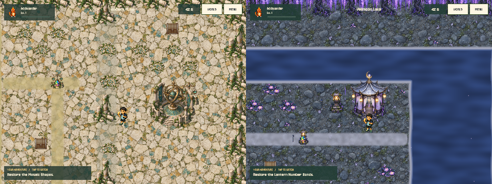
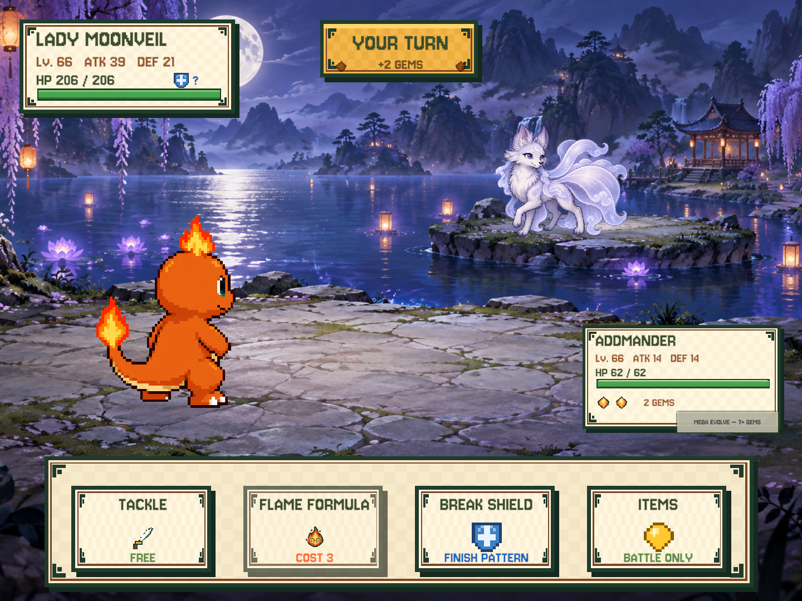

# Ancient Ruins and Veilmoon Lake

Expansion installed in place on the physical iPad on 2026-09-13. Lucas's iPad progress remains authoritative.

## Deployment record — 2026-09-13

- User confirmed saving and leaving the connected/unlocked iPad at the main menu.
- Fresh pre-install Documents backup: `~/Documents/Numeria Save Backups/ipad-before-1.1.0-SirBvdoR/Documents`.
- Active Slot 2: schema v10, Dark Mines, active family Scalip Lv.47, 548 coins, 41 companions, 43 opened chests, five crystals.
- Xcode signed Release 1.1.0 (2) from Numeria-6 using the existing development team; deep/strict signature verification passed. Installed under the unchanged `com.yuankunxue.numeria` without uninstalling.
- Before first launch, all four Documents files were copied to sibling `post-install-Documents` and matched the pre-install backup byte-for-byte, including the active-slot selector. No Mac progress was imported.
- Device app inventory confirmed 1.1.0 (2); launch succeeded. User confirmation of Slot 2 map/stats/audio is still pending; process launch alone is not full gameplay acceptance.
- Development provisioning expires `2026-09-20T03:02:23Z` (September 19, 20:02 PDT). Re-sign/update in place before expiry as needed; never uninstall to renew provisioning.

Slot 2 pre/post SHA-256: `9fbfb2a9126c761296942e7fe59b1ed51b7fbc803fb52a8e6ce90bbc75cec24a`.
Installation and launch records are local `/tmp/numeria-afterstory-install.json` and `/tmp/numeria-afterstory-launch.json`.

## Progression

| Chapter | Unlock | Wild levels | Fixed Boss | HP / ATK / DEF |
|---|---|---|---|---|
| Ancient Ruins | Clear Underground Tunnels | 50–58 | Grand Abacoracle, Lv.58 | 201 / 31 / 22 |
| Veilmoon Lake (幽冥湖畔) | Clear Ancient Ruins | 58–66 | Lady Moonveil, Lv.66 | 206 / 39 / 21 |

Use WORLD or SETTINGS travel to enter the ruins after the original ending. The six-crystal ending and original underground exit are unchanged. Expansion victories award Mosaic and Moonlight badges, derived from cleared-gate IDs, not seventh/eighth Digit Crystals. New bosses never follow the active companion's level. The existing Boss stat formula caps its chapter modifier at six; higher-level species provide the afterstory's progression.

Each 32×18 map has four discoveries, five optional chests, a merchant challenge/shop, weighted encounters, a guardian and a portal trial. Three discoveries restore crossings and unlock the guardian. Ruins use shapes, gear patterns and equality balance; the lake uses number bonds, symmetry and lotus patterns. These reuse the existing child-readable puzzle interfaces, not new freeform construction minigames. Arithmetic remains within 20. Solved passages are reconstructed from discovery IDs on reload.

## New families

| Family and evolution | Element | Evolution levels | Skill choreography |
|---|---|---|---|
| Tiletot → Mosaicub → Tessellion | Rock | 52 / 60 | Mosaic March: tiles assemble and a mosaic lion charges |
| Abacub → Beadwarden → Abacoracle | Mind | 52 / 60 | Balance Beam: paired beads settle and converge into light |
| Coglet → Gearling → Clockondor | Sky | 52 / 60 | Pattern Flight: a clockwork bird follows illuminated nodes |
| Gliminnow → Luminfin → Lanternray | Water | 60 / 68 | Lantern Current: a ray follows an arcing lantern trail |
| Wisplet → Veilkit → Moonveil | Fairy | 60 / 68 | Mirror Waltz: two mirrored fox silhouettes converge |
| Lilypadlet → Bloomboat → Lotustide | Grass | 60 / 68 | Lotus Sequence: blooms open along the attack path |

The roster is now 159 forms / 54 families, with normal and redesigned Mega art for all 18 new forms. New entries are appended, preserving old roster/family indices. Each family has one new visual kind; stages and Mega share its choreography. Existing skill button icons are reused. Bosses use the existing pattern shield/stun/Mega-capable battle loop, not bespoke multi-phase AI.

ImageGen produced the two battle paintings, two ground textures, two environment atlases and twelve creature sheets. Mechanical atlas extraction produces 36 individual creature PNGs. See [asset prompts and provenance](afterstory-assets.md). The two regions reuse licensed Sky/Mountains Jukebox moods with existing crossfade/ducking, rather than introducing unlicensed or newly generated music. New dialogue, encounters and evolution narration are baked offline by `NUMERIA_AFTERSTORY_ONLY=1 zsh tools/bake-voice.sh`.

## Save and deployment contract

- Schema v11 adds identities, not destructive field migration. Regression tests upgrade synthetic v10 progress and compare every serialized field except the version; capture offsets, inventory, chest/discovery IDs and completed story remain intact.
- Never use the Mac save to replace Lucas's newer iPad progress. No New Game, reset, uninstall or bundle-ID change is needed.
- Before installation, Lucas must save and connect/unlock the iPad. Copy its current Documents to a fresh external backup and verify it before a same-ID in-place update (`com.yuankunxue.numeria`). Inspect actual device logs, load the latest slot, and verify team, level, coins, chest state and audio.
- Code can be reverted with `git revert`, but an older v10 binary intentionally rejects v11 saves. Do not downgrade over newer play. Keep a pre-update v10 backup for deliberate rollback, or ship a forward-compatible fix. Restoring the old backup would lose subsequent play and requires an explicit user choice.

## Verification and remaining acceptance

Unity exported version **1.1.0 (2)** to local ignored `unity/Builds/iOS/Numeria-6/Unity-iPhone.xcodeproj`.
No older build folder was overwritten. The later signing and installation are recorded above.
Xcode Release arm64 compilation/linking succeeded with `CODE_SIGNING_ALLOWED=NO`; the unsigned local app is
`/tmp/numeria-afterstory-ios-derived/Build/Products/Release-iphoneos/Numeria.app`. Its plist confirms version
1.1.0 and bundle ID `com.yuankunxue.numeria`. Use `DEVELOPER_DIR=/Applications/Xcode.app/Contents/Developer`
when invoking xcodebuild on this Mac; the system default points to CommandLineTools. Do not change that global setting.

Unity EditMode 163/163 and Node prototype 15/15 passed. Chapter balance simulation now runs 8,192 synthetic battles across eight chapters, four existing families and four level offsets. All +10-level cases win under the tested policy (correct answers, appropriate evolution and Mega; no potions/equipment). This is not a claim about every species or a child's success rate.

`Numeria → Preview Afterstory` renders both maps, Boss battles, all six new spell kinds and the eight-region atlas at 4:3 using synthetic progress only. A sprite slicing defect involving overlapping bounding rectangles was found and fixed during visual inspection. Following installation, touch targets, performance, music, the real saved slot and a full playthrough still require gameplay acceptance.
