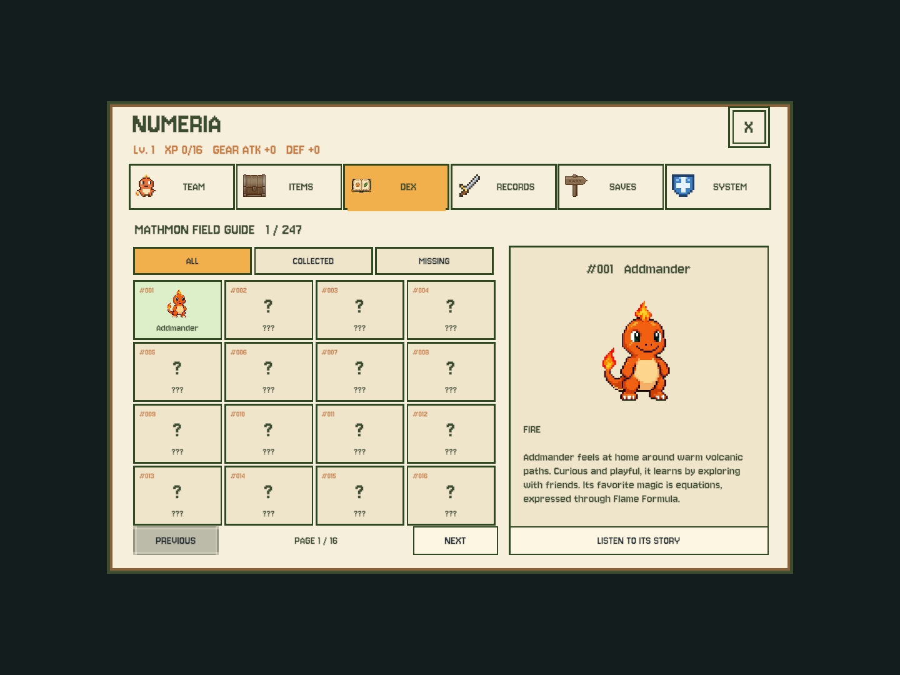
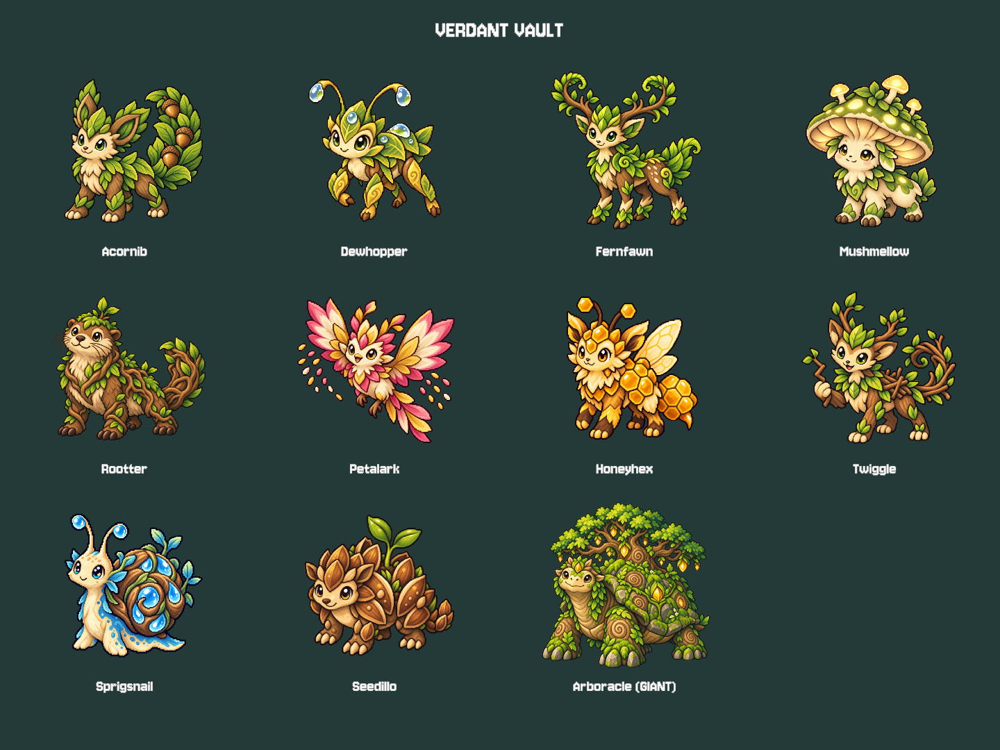
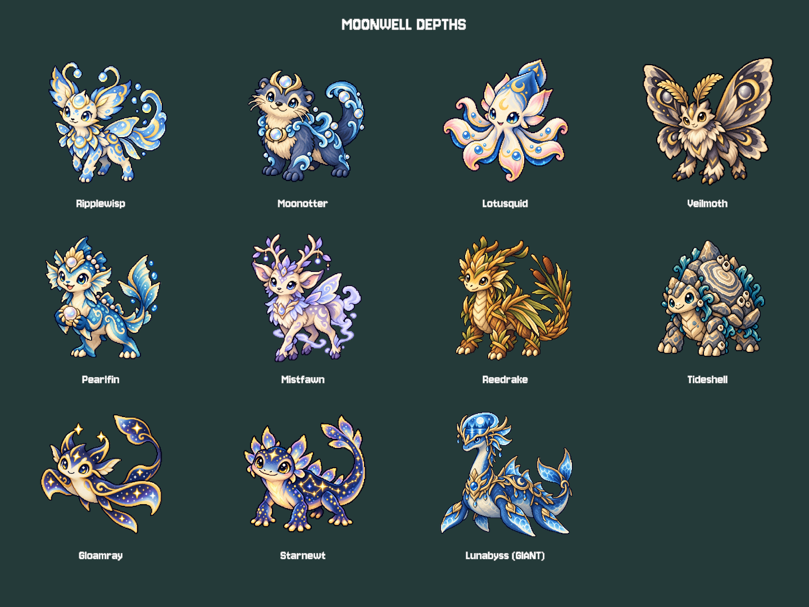
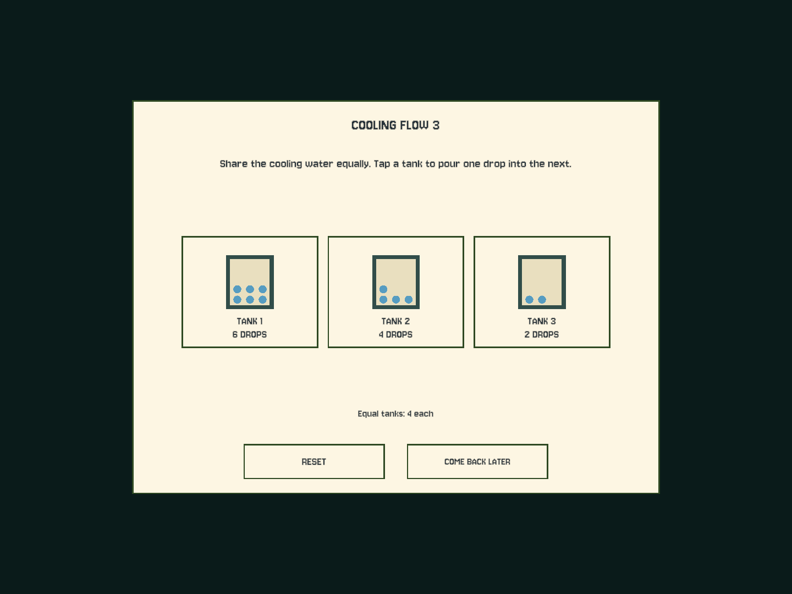
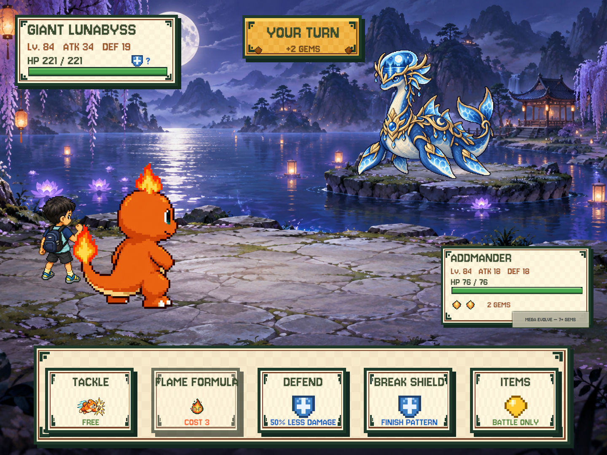

# Eight Depths — collection expansion

Confirmed scope: 159 existing forms / 54 families + 80 new ordinary species + 8 giants = 247 forms / 142 families. New depth species are independent single-stage families; existing evolution lines are unchanged. Team remains 99; lifetime collection is separate from ownership. Giant rewards must survive a full team.

DEX correction: **142 species/family entries**, each with internal evolution-form pages (247 total).
See [family-dex.md](family-dex.md); this correction is installed on the iPad in 1.4.1 (7).

## Verdant Vault — forest

Seed channels: Open seed channels to grow living bridges. Fixed guardian Lv.12, ordinary Lv.4–10. Access after parent guardian victory; return portal always available. Parent chapter determines math bounds; no automatic grade increase.

| Name | Type | Introduction |
|---|---|---|
| Acornib | GRASS | It sorts acorns into tidy piles before sharing them with the forest. |
| Dewhopper | BUG | It hops between dewdrops and leaves tiny counting trails on leaves. |
| Fernfawn | GRASS | Its fern antlers unfurl one matching leaf on each side. |
| Mushmellow | FAIRY | This sleepy mushroom glows when nearby friends finish a pattern. |
| Rootter | EARTH | It builds root dams and checks that every stream gets a fair share. |
| Petalark | FLYING | Its petal wings scatter seeds in repeating colored rows. |
| Honeyhex | BUG | It fits six-sided honey rooms together without leaving any gaps. |
| Twiggle | GRASS | It collects crooked twigs and turns them into straight number paths. |
| Sprigsnail | WATER | Its spiral shell stores a cool drop for each thirsty seed. |
| Seedillo | EARTH | Its armored seed plates roll apart to make space for a new sprout. |
| **Arboracle — giant** | GRASS | A gentle oak-backed tortoise shelters a whole garden beneath its canopy. |

## Rime Gallery — mountains

Echo bridges: Repeat mountain echoes to raise frozen crossings. Fixed guardian Lv.22, ordinary Lv.14–20. Access after parent guardian victory; return portal always available. Parent chapter determines math bounds; no automatic grade increase.

| Name | Type | Introduction |
|---|---|---|
| Snowmote | FAIRY | It drifts in matching snowflake pairs and never leaves a friend behind. |
| Rimehare | EARTH | It taps snowy steps in order before making its longest leap. |
| Icicub | WATER | Its ice paws leave little square prints along the frozen stream. |
| Chimegoat | ROCK | Its crystal horns ring a different note for each safe ledge. |
| Frostfinch | FLYING | It traces equal wings in the snow with every careful landing. |
| Glintmarmot | EARTH | It packs shiny stones into warm burrows in equal-sized groups. |
| Flurryfox | FAIRY | Its tail paints curling snow trails that always return to the start. |
| Quartzquill | ROCK | It counts its crystal quills to make sure none were lost in a tumble. |
| Sleetseal | WATER | It slides between ice circles and judges which route is shorter. |
| Peakpuff | SKY | This round cloud creature rests only on the tallest mountain cairns. |
| **Glaciomamm — giant** | ROCK | A great woolly mammoth carries an entire blue glacier on its curved tusks. |

## Zephyr Gardens — sky

Wind lanes: Turn wind vanes to connect floating islands. Fixed guardian Lv.30, ordinary Lv.22–28. Access after parent guardian victory; return portal always available. Parent chapter determines math bounds; no automatic grade increase.

| Name | Type | Introduction |
|---|---|---|
| Kitelet | FLYING | Its kite-shaped tail points toward the next safe gust. |
| Cloudcalf | SKY | It gathers small clouds into fluffy groups before falling asleep. |
| Gustgecko | FLYING | Its wide toe pads cling to moving stones high above the clouds. |
| Nimbusquid | WATER | It swims through mist and ties raindrops into neat little loops. |
| Vanevulp | ELECTRIC | Its copper ears turn together whenever the wind changes direction. |
| Plumepup | FLYING | It balances on one feather and counts down before gliding. |
| Halohare | FAIRY | Its glowing ear rings make matching circles in the evening sky. |
| Drifturtle | SKY | It sails between islands on a shell shaped like a tiny airship. |
| Zephyray | FLYING | It measures gusts with the long ribbons at the tips of its wings. |
| Aerolotl | DRAGON | It puffs little cloud stairs so smaller friends can climb with it. |
| **Stratocetus — giant** | SKY | An enormous sky whale carries floating gardens along the quiet upper winds. |

## Dusk Oasis — desert

Sun and moon: Switch sun and moon seals to reveal oasis paths. Fixed guardian Lv.42, ordinary Lv.34–40. Access after parent guardian victory; return portal always available. Parent chapter determines math bounds; no automatic grade increase.

| Name | Type | Introduction |
|---|---|---|
| Sandib | EARTH | It digs cool shelters with entrances arranged in matching pairs. |
| Duneling | EARTH | Its sandy curls change shape when it rolls down a new dune. |
| Cactot | GRASS | It stores water in round pads and shares one pad at a time. |
| Miragecko | SKY | Its glassy scales reflect paths that disappear when viewed from the wrong side. |
| Scarabacus | BUG | It rolls bright beads along its shell like a living counting frame. |
| Suncamel | FIRE | Its glowing hump keeps travelers warm after the desert sun sets. |
| Oasisprout | WATER | It grows beside hidden wells and folds its leaves at noon. |
| Glasscobra | ROCK | Its clear hood catches sunlight and splits it into colored shapes. |
| Saffronfox | FIRE | It follows the shadow of its tail to find the coolest route home. |
| Moonjerboa | FAIRY | It wakes at dusk to trace star patterns with its long jumping feet. |
| **Solarsphinx — giant** | EARTH | A giant sandstone sphinx shades the oasis beneath a crown shaped like a sundial. |

## Resonant Foundry — dark_mines

Power circuits: Link copper relays to light the abandoned foundry. Fixed guardian Lv.52, ordinary Lv.44–50. Access after parent guardian victory; return portal always available. Parent chapter determines math bounds; no automatic grade increase.

| Name | Type | Introduction |
|---|---|---|
| Oremole | EARTH | It taps tunnel walls and listens for the richest echo. |
| Copperbat | FLYING | Its copper-lined wings carry sparks between distant cave lamps. |
| Geodillo | ROCK | It rolls up into a hollow geode when a tunnel gets noisy. |
| Voltweevil | ELECTRIC | It joins broken wires with the two tips of its glowing snout. |
| Coalcrab | FIRE | It carries warm coal in a shell that never burns its friends. |
| Amethystot | FAIRY | Its purple crystals pulse together when a circuit is complete. |
| Railrook | FLYING | It rides mine carts and calls out the order of each junction. |
| Nickelnewt | ELECTRIC | It slips through narrow seams and polishes them with its silver tail. |
| Lumenlug | BUG | Its lantern belly lights one square of the tunnel at a time. |
| Pyritoad | ROCK | It guards glittering fool's gold but happily trades for smooth pebbles. |
| **Magnetaur — giant** | ELECTRIC | A towering iron bison pulls loose ore into orbit around its magnetic horns. |

## Ember Reservoir — underground

Cooling flow: Route cooling water to turn molten channels into stepping stones. Fixed guardian Lv.62, ordinary Lv.54–60. Access after parent guardian victory; return portal always available. Parent chapter determines math bounds; no automatic grade increase.

| Name | Type | Introduction |
|---|---|---|
| Ashaxol | FIRE | Its feathery gills sift warm ash into soft piles. |
| Basaltot | ROCK | It stacks black stones into small towers beside cooling lava. |
| Cindercricket | BUG | It chirps a repeating rhythm whenever a vent is ready to cool. |
| Steamink | WATER | It draws temporary arrows in clouds of gentle steam. |
| Obsidianole | ROCK | Its glossy scales mirror the orange glow of underground rivers. |
| Magmole | EARTH | It digs side channels so hot streams never flood a friend's burrow. |
| Emberfin | FIRE | It swims through glowing pools without disturbing their calm surface. |
| Ventviper | FIRE | It curls around warm vents and releases heat in careful little breaths. |
| Pumipup | ROCK | Its airy stone paws let it float across warm pools. |
| Sootsprite | FAIRY | It sweeps soot into star shapes before the morning lamps are lit. |
| **Calderadon — giant** | FIRE | A colossal basalt salamander carries a sleeping caldera along its broad back. |

## Chronicle Archive — ancient_ruins

Living mosaics: Restore mosaic keys in order to open the sealed archive. Fixed guardian Lv.74, ordinary Lv.66–72. Access after parent guardian victory; return portal always available. Parent chapter determines math bounds; no automatic grade increase.

| Name | Type | Introduction |
|---|---|---|
| Glyphimp | MIND | It copies ancient marks and spots the one symbol that does not belong. |
| Tesselkid | ROCK | Its tiled coat rearranges itself into patterns with no empty spaces. |
| Papyrill | BUG | Its parchment wings preserve tiny stories from forgotten classrooms. |
| Cogcrab | EARTH | It walks sideways through old gears without missing a single beat. |
| Sundialynx | SKY | Its long shadow points to the safest doorway in the archive. |
| Mosaicarp | WATER | Its colored scales fit together like pieces of a river mosaic. |
| Abacat | MIND | It slides golden beads along its whiskers while watching the stars. |
| Relicub | ROCK | It carries broken statues to a quiet corner and patiently rebuilds them. |
| Scrollfinch | FLYING | It unrolls its tail feathers to show the route it flew yesterday. |
| Prismidol | FAIRY | It turns one shaft of light into a carefully ordered rainbow. |
| **Chronogolem — giant** | MIND | A monumental clockwork archivist keeps lost stories safe inside a rotating stone library. |

## Moonwell Depths — veilmoon_lake

Moon tides: Tune moon mirrors to lower the tide and reveal hidden islands. Fixed guardian Lv.84, ordinary Lv.76–82. Access after parent guardian victory; return portal always available. Parent chapter determines math bounds; no automatic grade increase.

| Name | Type | Introduction |
|---|---|---|
| Ripplewisp | FAIRY | It draws bright rings on still water without making a sound. |
| Moonotter | WATER | It shares round moonstones by making equal piles along the bank. |
| Lotusquid | WATER | Its petal arms open together when moonlight touches the lake. |
| Veilmoth | BUG | Its wings hide a matching pair of silver eyespots. |
| Pearlfin | WATER | It polishes one pearl for every new friend it meets. |
| Mistfawn | FAIRY | It steps between islands on paths made from low silver mist. |
| Reedrake | DRAGON | It weaves reeds into little bridges for creatures that cannot swim. |
| Tideshell | ROCK | Its shell records each rising tide with another pale ring. |
| Gloamray | SKY | It glides just above the lake and gathers reflected stars. |
| Starnewt | FAIRY | Its back lights up in constellations that change when the tide turns. |
| **Lunabyss — giant** | WATER | An immense moonlit plesiosaur watches over a lake reflected inside its luminous crest. |

## Release safety

The 88 additions are single-stage base forms, including the eight giants. Separate Mega artwork is a follow-up scope; these newcomers do not offer the Mega button yet. All 159 pre-existing forms retain their Mega profiles and independent portraits unchanged. Never fake a new Mega by copying its base portrait.

Expansion installed as **1.4.0 (6)**; see [device/save verification](ipad-1.4.0.md). Additive v13 migration records lifetime collection, defeated giants and pending rewards; existing world layouts, chest IDs, individual stats, equipment and learning settings are retained. Older saves can prove only the starter and each currently owned form, so historical released/evolved-away forms are not guessed. New catches and evolutions permanently register their exact forms.

Back up the latest iPad Documents before any future install; never restore an older Mac/device snapshot. Keep the same bundle ID and install in place, never uninstall. Code can be reverted, but a v13 save must not be opened with the old v12 build; keep a pre-update device backup separately. No actual Mac or iPad player saves were loaded or modified during this work.

Giant friendship is awarded once after victory. A full team does not lose the reward: it remains under DEX until a slot is free. Repeated claims cannot duplicate the giant. The awarded partner uses its species' normal growth at the fixed challenge level, not the opponent's temporary Boss HP/ATK/DEF bonuses. Giants are not added to ordinary encounter tables or probabilistic catching. The original six crystals and two afterstory badges are unchanged.

## Verification (2026-09-25)

- Unity EditMode **204/204** passed; Node prototype **15/15** passed; `git diff --check` clean.
- All 24 mechanism instances have tested solutions and free resets. Every map's mechanisms, return route, final guardian, encounter bushes and chests pass reachability checks; guardian routes remain blocked until the required sequence is complete.
- Coverage checks 247 unique form IDs, 142 families, 80 ordinary additions, eight distinct giants, exact fixed Boss levels, persistent collection after release, unknown-entry secrecy, stable dex selection/page, v12 migration, save round-trip, full-team pending rewards and idempotent claiming.
- All 88 independent new portraits and the field-guide icon load as runtime sprites. Import sizes are capped at 512/128 pixels; the first batch's previously larger settings were corrected and regression-tested. Existing 159 Mega assets remain available.
- Offline narration manifest has 808 unique lines, adding 802 WAV clips while reusing existing duplicates. Export with `Numeria → Export Depth Narration`; bake with `zsh tools/bake-voice.sh --depth-only`.
- `Numeria → Preview Field Guide and Depths` renders synthetic (not Lucas's) data: 4:3 collection UI, all eight mechanism screens, eight roster sheets, eight giant battle compositions and eight exploration maps. No player save access. Actual iPad touch, audio playback, memory/performance and child-play difficulty still need device acceptance.
- New layers reuse their parent's terrain, props, battle painting and music, and use existing elemental skill choreography. They are not eight newly painted background sets or 88 unique spell animations. See [generation mode, prompts and asset paths](eight-depths-assets.md).

## Representative editor previews

These use synthetic progress and do not show Lucas's save.

