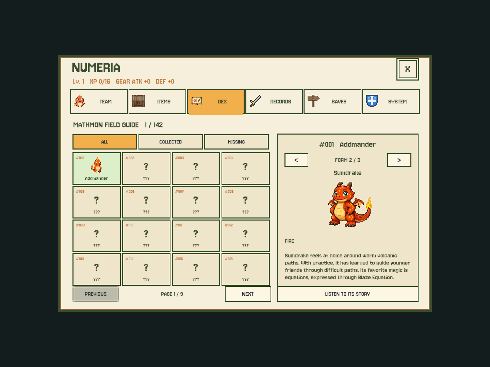

# Family-based DEX correction — September 25, 2026

Local implementation; **not yet installed on the iPad**. Installed 1.4.0 (6) still uses separate form entries.

The collection unit is one evolution family: **142 Mathmons**, containing **247 ordinary evolution forms**.
Addmander → Sumdrake → Equadragon is one numbered entry, not three species to collect.
All 88 expansion additions remain independent single-stage entries.

- The main 16-card/page list, numbering, total and ALL/COLLECTED/MISSING filters operate on families.
- Obtaining any form marks that family collected. Further evolutions never increase the family count.
- Inside a selected entry, `<` / `>` controls show `FORM 1 / 3`, `FORM 2 / 3`, etc.
  Each form has its own portrait, name, story and narration. Unknown forms stay `???` without art/story/audio.
- Family cards use the family's base name and the earliest actually recorded form's portrait. If only
  an evolved form was captured, opening that family starts on the recorded form instead of an empty base page.
- Entirely uncollected families remain question marks. Form navigation does not move the main list page
  or change its selection. Single-stage entries show `FORM 1 / 1` with disabled navigation.
- The encounter assist uses the same family definition. No form from an already collected family is
  treated as a brand-new Mathmon for the 60% priority pool. Original relative form weights remain intact.
- `CollectedForms` stays unchanged: derive family membership from existing exact-form history. No save
  schema change (still v13), data rewrite, progress reset, real-save access or device installation.
  Releasing a partner does not erase either its family registration or its form history.

Validation: Unity **215/215**, Node **15/15**. Tests cover unique family numbering, 247 internal pages,
family count after evolution/release, evolved-only discovery, form privacy, stable outer pagination,
filters, existing single-stage giants and family-aware encounters. Three 4:3 synthetic UI fixtures rendered;
known second-stage and unknown third-stage pages visually checked.

Source-code rollback can revert this commit without reverting or deleting any player's collection history.
