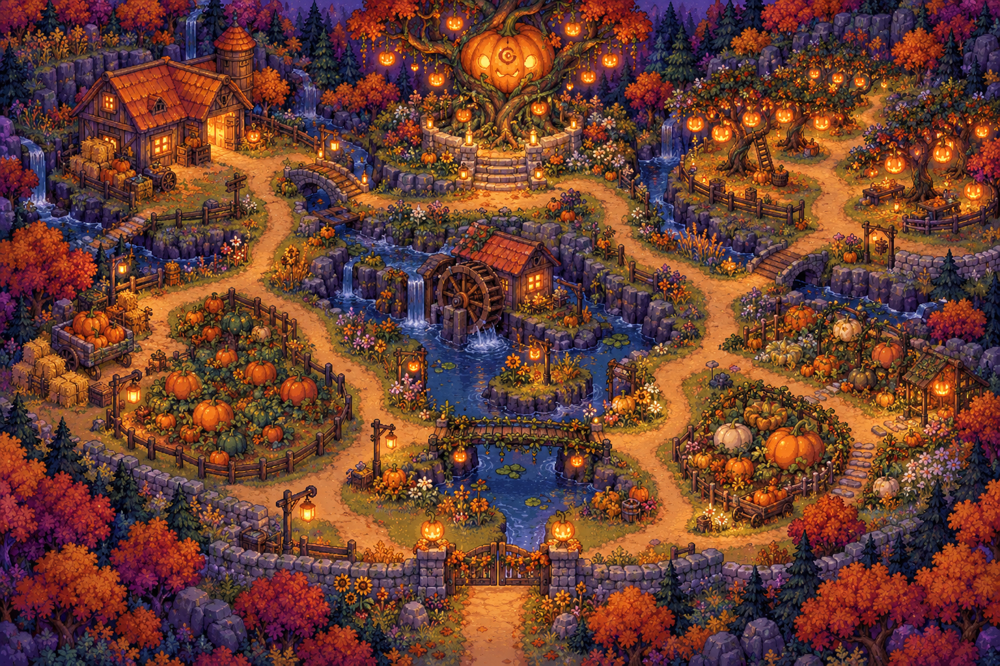
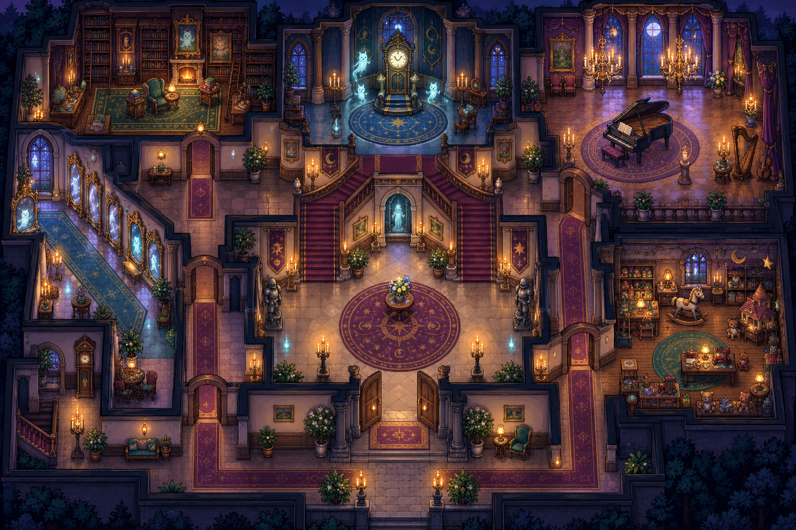
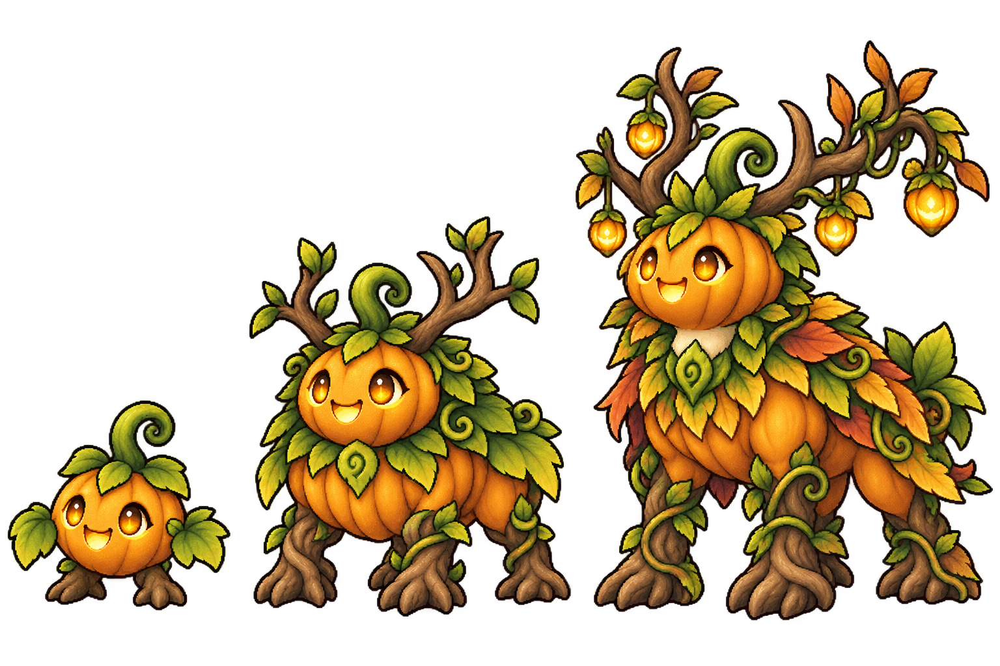

# Halloween worlds and three-stage evolution

日期：2026-10-15。**设计稿，尚未接入游戏，也未安装到 iPad。** 本轮交付完整家族目录、地图玩法、美术概念与兼容要求；概念图不是可直接运行的 Tilemap 或切好的战斗精灵。

## 范围与数量

新增 Spooky Pumpkin Patch（幽灯南瓜田）与 Haunted House（幽灵宅邸，将用户的 “hunted house” 理解为此名称）。每图 15 个独立家族，每家族三阶段；两位地图 Boss 使用其中一个家族的最终形态，不另加第 16 个家族。

| 内容 | 家族 | 形态 |
|---|---:|---:|
| 当前主世界阵容 | 54 | 159 |
| 当前八扩展层，全部单阶段 | 88 | 88 |
| 为这 88 个家族各补两个形态 | 不新增 | +176 |
| 两个新世界，各 15 条三阶段家族 | +30 | +90 |
| 完整接入后的目标 | **172** | **513** |

总计新增 **266 个形态**。八只既有巨型守护兽包含在 88 家族内，也补齐三阶段。Countipillar、Doublit、Mirrowl 原本已有两阶段，不属于此次“没有进化路线”的范围；其余既有进化链不改。DEX 始终按家族计数，在详情内翻形态页，不能变成 513 个图鉴条目。

基线来自 `GameData.cs` 与 `DepthCatalog.cs`，不是早期设计文档中的旧 roster 数字。旧家族逐条设计见 [88 家族进化补全](depth-evolution-design.md)。

## 等级与解锁

暂按“最后一张地图”指 **Moonwell Depths** 设计：该图普通遭遇 Lv.76–82，巨型守护者固定 Lv.84。另一可能参照 Veilmoon Lake 主世界为 Lv.58–66、Boss Lv.66，等待用户选择；如采用后者，两图野怪改为 58–66、Boss 66、新家族进化门槛改为 68/76，地图与阵容不变。

默认方案：两图普通野怪 Lv.76–82；Boss 固定 Lv.84，不追随我方等级上涨。野怪保留该范围内现有等级选择与 HP 92%–108% 波动。基础形态是正常可用的高等级伙伴，不因“第一阶段”回到 Lv.1 数值。

两图是并行的后期支线，均在 Veilmoon Lake 的 GateCleared 后由 WORLD 解锁。无需先清 Moonwell，也不要求先打完南瓜田才进宅邸。WORLD 增加两张目的地卡；Veilmoon 既有安全区域可增加一个 Halloween Waygate 交互入口，但不移动旧地图宝箱、出口和机关。进入后有始终可用的返回门，返回 Veilmoon 安全落点；不增加主线水晶数量，不重新锁住已有世界。

两个新 ID 固定为 `spooky_pumpkin_patch`、`haunted_house`。它们不是塞进八扩展层数组的第九、第十条，不得依赖已有八种机关的索引推算。

## Spooky Pumpkin Patch



**体验：让一座暮色南瓜农场重新亮起来。** 玩家从安全的集市入口出发，经过水车、南瓜畦、稻草谷仓与灯笼果园，最后唤醒丰收树下的 Crownkin。橙金灯火与蓝紫暮色构成对比；田地有大小和疏密变化，不能把同一南瓜均匀铺满整个地面。

目标可步行区域约 56×40 格，具体边界随拼图资源调整。主路至少两格宽，转角与路口三格宽。空间连接如下；连线表示实际可走连接，概念图不作为碰撞依据。

```text
                   丰收树庭 / Crownkin
                      /           \
                 谷仓台地 —— 灯笼果园
                     |             |
                  西南瓜畦 —— 水车 —— 东南瓜畦
                     \       |      /
                       安全集市与返回门
```

水车周围的环路从进入时就能走；机关开启近路与奖励区，不能让失败玩家被困在另一岸。三件任务任意顺序完成，途中每完成一件持久保存：灌溉生长、丰收分装、灯笼点亮。全部完成可挑战 Boss，不要求开完所有普通宝箱。

| 区域 | 主要家族 | 视觉与探索奖励 |
|---|---|---|
| 西南瓜畦 | Pipkin、Squashkit、Pumpup、Seedlet、Gourdillo | 藤蔓桥、种子盒、低矮栅栏；最早可见五种南瓜轮廓 |
| 水车与湿地 | Cobblekin、Pumprib、Coilseed | 水渠、浅池、滑动水闸；开闸后出现支路 |
| 谷仓台地 | Hayhoot、Pulpuff、Tallygourd | 草垛、秤盘、粮仓；屋后是非必需收藏路线 |
| 灯笼果园 | Lanternib、Vinebat、Stemstag、Spookernel | 高低错落的暖灯、紫叶树；树后隐藏可见轮廓的宝箱 |

每个生态区使用 5–7 个家族的遭遇池：上表为主栖息地，再混入相邻区域家族，避免只剩同一种怪。安全集市没有随机战斗。15 个基础形态都可通过探索收集，不设现实日期、夜间时间、付费或联网限制。

### 南瓜田机关

| 机关 | 玩家实际操作 | 成功后的世界变化 |
|---|---|---|
| Growing Channels | 旋转真正有入口/出口的水渠，连接水源与两株幼苗；逐格流动预览，不显示可直接照抄的方向答案 | 水确实流过去，藤蔓长成桥；无效支路显示断流位置 |
| Harvest Shares | 把画出来的南瓜拖到篮筐，满足当前年级的数量/相等/分组条件；篮筐实时显示可数的内容 | 小车运走收成，谷仓侧门开启 |
| Lantern Pattern | 在一条仍可看见的灯笼序列中补缺项，不是重抄完整目标 | 正确的一组依次亮起，果园近路开通 |

新地图视觉采用手绘像素质感，但必须由可重用地块、边缘、道具组合。概念图中的高差、桥和水车需在实际 Tilemap 上验证通路；不能直接把整张概念图铺在脚下冒充可玩的场景。

## Haunted House



**体验：帮助友善幽灵找回宅邸丢失的晚会。** 内部探索采用俯视剖面：门厅、镜廊、画像书房、音乐厅、玩具房与钟楼。人物走到高墙和家具后时遮挡层淡出；用地毯与门框引导路线，不能依赖漆黑遮罩制造恐怖。

目标可步行区域约 52×44 格，允许用房间切换替代一次展示全屋。门厅是安全区，包含返回门、房间示意图和已完成机关标记。左侧书房—镜廊与右侧音乐厅—玩具房各有一条回门厅的环路；三件任务完成后开放钟楼，挑战 Chronophantom。

```text
         画像书房 —— 钟楼 / Chronophantom —— 音乐厅
            |                 |                 |
          镜廊 ———————— 安全门厅 ———————— 玩具房
                              |
                           返回门
```

概念图只确定氛围与房间主题；书房、音乐厅到钟楼的连线要落实为门/走廊，不以画上相邻或楼梯方向推断可达。钟楼未开时两侧环路仍能返回门厅。

| 区域 | 主要家族 | 可识别的环境语言 |
|---|---|---|
| 镜廊 | Wispip、Sheetot、Mirrorimp、Dustmew | 银框镜面、倾斜月光、青色幽火；镜面与地面边界清楚 |
| 画像书房 | Inklit、Pagepeek、Mousoleum、Keyboo | 旧书、墨水、可对话画像、钥匙形门楣 |
| 音乐厅 | Bellbit、Batboo、Teacreep | 钢琴、钟铃、会漂浮的茶具；可重复播放的音符灯 |
| 玩具房 | Toyboo、Sockling、Candlepup、Tickaboo | 玩具马、针线篮、暖色小灯；怀表幽灵在这里首次出现 |

幽灵是有性格的伙伴，不是换颜色的漂浮光球。每家族有一个清晰物件或动物轮廓；不使用血腥、腐烂、突然贴脸或惩罚性追逐。不会把旧 Veilmoon 生物改为 GHOST，避免既有存档属性变化。

### 宅邸机关

| 机关 | 玩家实际操作 | 成功后的世界变化 |
|---|---|---|
| Mirror Guests | 按可见对称轴放置客人的影子；位置与朝向必须真正镜像，不能只反转一行字母 | 镜中客人走出，打开镜廊捷径 |
| Portrait Places | 用画像的语音线索确定位置，保留可重听的线索卡；不是看一遍答案再排序 | 画像互相打招呼，书架滑开 |
| Midnight Melody | 先实际播放音符并同步点亮对应按钮，再按序重奏；LISTEN 可完整重播 | 灯光跟随正确节拍，音乐厅通往钟楼的门亮起 |

## 30 条新家族

下面每行是一条家族，不是三个独立种类。新家族 BaseId 与三形态 ID 均使用英文名的小写；名字仅含 ASCII 字母。全部为原创数灵，三阶段保持识别特征，但轮廓、肢体或装备结构必须成长，不能把同一图片放大或变色。

每图各有五条攻击、五条防御、五条均衡路线。这里的定位只影响 HP/ATK/DEF 与演出；不引入尚不存在的速度、属性免疫、持续中毒或睡眠系统。所有新家族默认 Lv.84 → Lv.92 进化，完整条件见下文。

### 南瓜田的 15 条 PUMPKIN 家族

所有三阶段均显示 `PUMPKIN` 属性与南瓜图标，不借用 GRASS 标签；数学特征体现在身体图案、介绍和技能演出，不强制绑定每次施法题型。

| 初始形态 | 第二阶段 | 第三阶段 | 定位 | 三阶段外形 | 技能演出主题 |
|---|---|---|---|---|---|
| Pipkin | Vinejack | Crownkin | 均衡 | 圆南瓜芽 → 根足与枝角守卫 → 挂灯枝角的丰收王；Boss 家族 | Seed Spark → Vine Lantern → Harvest Crown：种子弧线、藤蔓点灯、枝冠灯阵落下 |
| Squashkit | Gourdpounce | Harvestlynx | 攻击 | 小南瓜猫 → 卷藤尾豹猫 → 镰叶耳与条纹瓜甲猞猁 | Rind Pounce：跳跃、双落点残影、最终收束为瓜叶交叉爪痕 |
| Pumpup | Vinehound | Gourdmastiff | 防御 | 瓜壳幼犬 → 编藤肩甲猎犬 → 宽胸南瓜獒 | Rind Ram：低身蓄力，瓜甲正面冲撞，护甲碎光不持续挡视线 |
| Seedlet | Sproutimp | Patchsage | 均衡 | 一颗会走的瓜籽 → 戴叶帽的芽精 → 藤杖与籽荚斗篷园丁 | Seed Array：种子排成两行，再合拢命中 |
| Gourdillo | Rindroller | Cucurguard | 防御 | 分瓣瓜甲犰狳 → 环形滚甲 → 多层错缝瓜盾兽 | Shell Roll：收壳滚动，升级后地面留下清晰的分段轨迹 |
| Lanternib | Wickgourd | Beaconkin | 均衡 | 小提灯南瓜 → 双盏叶臂灯灵 → 三层灯塔瓜灵 | Lantern Beam：一束暖光、分束、汇聚为一道宽光束 |
| Cobblekin | Stonegourd | Terrapump | 防御 | 石底瓜壳龟 → 台阶状厚壳 → 背负小南瓜园的岩龟 | Terrace Pulse：三层地面波从脚下依次向敌方传播 |
| Pulpuff | Creamkin | Piemancer | 均衡 | 绵软南瓜团 → 螺旋奶油冠 → 派边披肩与烤盘尾的团子兽 | Slice Swirl：派片绕一圈再合成完整圆盘命中，不强迫低年级学分数 |
| Vinebat | Gourdfang | Patchwing | 攻击 | 南瓜头叶翼蝠 → 藤骨大翼 → 钩藤尾与扇形瓜叶翼 | Vine Swoop：V 形俯冲、两侧叶痕、回旋收尾 |
| Hayhoot | Strawloft | Scareowl | 攻击 | 瓜脸草绒鸮 → 草帽与扇尾 → 扇形稻草披风守田鸮 | Straw Spiral：草穗旋风从脚下卷到目标，不复用火球 |
| Pumprib | Gourdcroak | Boglantern | 防御 | 瓜背小蛙 → 荷叶瓜甲蛙 → 灯笼喉囊与莲叶足大蛙 | Pond Rings：一、二、三圈暖色水波沿地面扩散 |
| Coilseed | Vineserp | Gourdaconda | 攻击 | 卷藤籽蛇 → 瓜节长蛇 → 叶冠与多节南瓜巨蟒 | Coil Count：连续瓜节绕敌成环，随后解开；仅演出，不附带束缚状态 |
| Stemstag | Rindbuck | Antlergourd | 防御 | 南瓜斑小鹿 → 树皮瓜甲公鹿 → 分叉叶角的南瓜雄鹿 | Branch Charge：角尖亮起成对叶光，踏步蓄力后直线冲撞 |
| Spookernel | Hexhusk | Lanternmoth | 攻击 | 披籽壳的小虫 → 悬空六瓣蛹 → 灯笼纹大叶蛾 | Petal Hex：六枚瓜籽依次亮起再组成六边形冲击 |
| Tallygourd | Abacush | Sumharvest | 均衡 | 两串籽珠瓜灵 → 拨珠叶臂 → 三排籽珠壳的丰收算盘兽 | Seed Sum：左右两组种子汇入中间，合并爆出金叶 |



Pipkin 家族图鉴故事方向：小家伙每分享一颗种子就点亮一盏灯；Vinejack 帮迷路者照出回家的路；Crownkin 在丰收夜把整座果园的灯连成一顶王冠。英文语音按三个阶段分别写，不用一段模板换名字。

### 宅邸的 15 条 GHOST 家族

所有三阶段均显示 `GHOST` 属性与幽灵图标。幽灵有可命中的轮廓，Tackle 照常生效；本版本不增加属性克制表，避免孩子没有可用招式。

| 初始形态 | 第二阶段 | 第三阶段 | 定位 | 三阶段外形 | 技能演出主题 |
|---|---|---|---|---|---|
| Wispip | Lanterngeist | Luminarch | 均衡 | 一团有眼睛的小幽火 → 提灯罩火灵 → 多环悬灯与长尾的灯灵王 | Wisp Orbit：小火环绕，逐阶段增加不同半径的同心轨道 |
| Sheetot | Drapewisp | Velourgeist | 防御 | 小方巾幽灵 → 帘边斗篷 → 天鹅绒双翼的飘毯守卫 | Curtain Sweep：折起、展开、扫出一面柔光；不做黑屏 |
| Keyboo | Latchling | Lockwarden | 防御 | 单把幽灵钥匙 → 双齿钥匙臂 → 门锁胸甲与钥匙环守卫 | Key Turn：钥匙飞到目标前转半圈，锁形光纹打开后散开 |
| Tickaboo | Penduloom | Chronophantom | 均衡 | 怀表幽灵 → 摆钟幽灵 → 三环时轮与披风落地钟；Boss 家族 | Tick Spark → Pendulum Arc → Midnight Chime：滴答光、钟摆扇弧、三轮钟光 |
| Inklit | Quillshade | Scriptreign | 攻击 | 墨滴小灵 → 羽笔尾墨灵 → 书法翼与墨带冠 | Ink Arc：可见弧线画出一道符号后命中，墨迹立即清除 |
| Dustmew | Veilcat | Phantomlynx | 攻击 | 灰尘绒小猫 → 纱尾幽猫 → 月光须与飘带四肢的灵猫 | Silhouette Leap：影子先移动，实体沿影子路径扑击 |
| Bellbit | Chimeraith | Carillord | 均衡 | 一枚小铃 → 双铃翼 → 多层钟裙与音叉冠 | Bell Echo：同步亮起的音环逐层向目标扩散，配短铃音 |
| Mirrorimp | Reflecter | Speculord | 防御 | 小镜框精 → 两面折镜 → 银框三折镜守卫 | Silver Fold：镜像左右合拢成光片，不冒充反伤机制 |
| Toyboo | Marionox | Puppetarch | 均衡 | 纽扣脸木偶 → 关节清晰的提线玩偶 → 木马纹披肩与飘浮木偶冠 | Puppet Parade：两只小木偶影像同步踏步，最后合为一次命中 |
| Candlepup | Wickwolf | Candelupus | 攻击 | 烛焰尾小犬 → 双烛肩狼 → 烛台角与流蜡鬃灵狼 | Wick Rush：烛光沿地面奔向目标，尾部只留短暂蜡光 |
| Pagepeek | Foliofloat | Tomewarden | 防御 | 躲在一页纸后的小灵 → 悬空打开的书 → 书页甲与书脊盾的守书灵 | Page Fan：书页展开为扇形，按页数逐层推近敌人 |
| Teacreep | Cupwisp | Porcelgeist | 均衡 | 小茶杯汽灵 → 双杯耳 → 茶壶身与杯托裙 | Tea Spiral：茶汽绘出螺旋，杯托光环收束命中 |
| Batboo | Echoveil | Sonarshade | 攻击 | 半透明小蝠 → 波纹耳大蝠 → 星幕双翼与环形声纹 | Echo Sweep：扇形声波，清楚显示源点到命中点 |
| Sockling | Mittenmist | Quiltguard | 防御 | 袜子耳小幽兔 → 手套叶形耳 → 拼布盔甲与毯尾幽兔 | Patchwork Wave：拼布方块拼齐后推出一道柔光 |
| Mousoleum | Cryptmouse | Vaultwhisk | 攻击 | 藏在小石屋中的幽鼠 → 石拱背甲 → 彩窗耳与钥匙须灵鼠 | Secret Passage：小门在目标两侧开启，鼠影穿门完成一次冲击 |


Tickaboo 家族图鉴故事方向：Tickaboo 帮玩具按时入睡；Penduloom 用钟摆给舞步打拍子；Chronophantom 记得每一位曾到访的朋友，在午夜为他们奏钟。这里的“午夜”是故事氛围，不限制现实可游玩时间。

## 遭遇与 Boss

基础阶段是新地图野外的默认形态；进化的中间/最终阶段由培养获得。这样每种新家族都有明显成长过程，不会一进地图就跳过三个形态的体验。Boss 家族的基础形态也在普通遭遇池，不设漏掉就永久不可收集的形态。

沿用当前按家族判断的收集倾斜：60% 未收集家族池 + 40% 原生态池；必须应用于当前生态区可出现的家族，而不是凭空抽出另一房间的怪。Master 沿用当前 30% 基础概率与连续四次普通后下一次保底、20%–40% 强化规则；不对固定 Boss 或捕获率叠加收集倾斜。

Boss 分别为 Crownkin、Chronophantom，固定 Lv.84，与我方等级/队伍最高等级无关。采用现有 Boss 数值曲线作为初始基线，专属演出只改变表现，不偷偷增加免疫或必杀。南瓜王先亮左右枝灯再汇聚攻击；古钟先显示摆钟方向再释放钟环，让 DEFEND 的时机可读。若加入蓄力状态，必须显示 NEXT: HEAVY HIT 与可重听语音；不能仅靠理解英文或猜动画决定防御。

首次胜利解锁区域纪念标记、快捷传送和一件固定装备，不直接赠送第三阶段伙伴，以免跳过养成。挑战可以重试，奖励只发一次。家族由普通基础形态捕获后进化；既有八巨型挑战的直接结交规则保持不变。

## 三阶段进化与数值

沿用主动进化：等级达标 + 持有足够进化石 + 现有进化试炼。当前 `CanEvolve` 检查 Stage+1 枚石头，`AdvanceEvolution` 不消耗石头；本扩展保持这种**可重复使用的资格道具**语义，不把 118 条待补/新增家族变成需要 354 枚消耗石的任务。UI 必须显示“拥有/需要”，不标 COST。第一阶段升第二阶段需要持有 1 枚，第二升第三需要持有 2 枚。

新家族的两道等级门槛为 84/92。已有 88 家族按所属地图设置门槛，见附表。高于门槛的旧伙伴在更新后显示 READY，但仍由玩家分别确认两次进化，不在读档时自动变形。Lv.99 伙伴也能正常触发两个尚未完成的进化，不要求再升级。

数值初稿按普通、巨型分别处理：

- 旧 88 家族第一阶段的 HP/ATK/DEF、成长、技能和捕获偏移保持逐值不变。不能重排 `DepthCatalog.Roster()` 的索引后再用 `i % 5` 计算旧基础数据；应先固化现值，新增阶段独立配置。
- 普通第二、第三阶段的同等级裸值目标分别约为第一阶段的 HP 1.12/1.25、ATK 1.10/1.20、DEF 1.10/1.20。巨型已有明显血量优势，使用较小增幅：HP 1.06/1.12、ATK/DEF 1.04/1.08。各倍率都相对原第一阶段，不逐次复利。
- 落地时写入显式 `SpeciesDef` 基础与成长整数，使用 `GrowthSystem.StatAtLevel` 的原取整方式；上面的倍率是拟合目标，不额外乘整个玩家最终数值。捕获时的三项 offset、训练奖励和装备加成在新形态裸值之外各加一次。
- 新家族基础形态在 Lv.80 裸值目标区间为 HP 110–140、ATK 43–54、DEF 36–45；攻击型向 ATK 上端、DEF 下端，防御型反之，均衡居中。区间不是对既有怪物的重新归一化。技能基础威力暂定 5/6/7，最终须用现有伤害公式模拟后调整。
- 不叠加新的属性克制；PUMPKIN 与 GHOST 首先用于物种身份、图标、语音与专属视觉。不能产生 “???” 类型回退。

普通同级战斗以 4–8 次有效攻击、Boss 8–14 次有效攻击为初步调参目标，不含读题时间；最低伤害连打与高防御组合要单独测试。需要模拟低/中/高装备、三种定位、Lv.76/82/84/92/99、DEFEND 和 Boss 护盾。不能把这些目标回合数当作已验证结果。

## 数学与朗读约束

战斗和宝箱继续使用已有年级、Feel Good/Normal/Challenging/Random 设置与跨战斗题型轮换。数灵等级不等于数学年级；两张地图先使用末章学习难度预算，不按“第九、第十章”越过家长选定年级的上限。图鉴中的“数学性格”和技能名称也不能把施法重新锁定为一种题型。

地图机关同样接入这些设置：K 使用可数图案与小范围数量；G1 增加选定范围内加减、数的组成与位置；G2 使用合法题池内等组/进位与图形；G3–5 使用各自既有题池许可的乘除、分数、测量、坐标。这里是玩法主题映射，不替代 `LearningSettings` 的合法题型与数值检查。高年级仍需可视化，不靠长英文阅读增加难度。

Feel Good 减少选项和步骤、提供持续可见示例；Normal 给一条完整线索；Challenging 增加本年级合法的约束或缺项；Random 在年级范围内混合。水渠连通、镜像、旋律的交互复杂度也要有上限，不以更大的数字替代设计。

所有题目、机关线索与说明保留小喇叭 LISTEN：重读当前完整题，不重抽、不清空操作、不自动提交；旋律先有实际声音并同步视觉按钮，可重播。新增语音必须离线可用，关键按钮触控至少 44pt。无倒计时；错误不扣血、不扣钱，可撤销；退出后机关完成状态保留。需要提示时解释断点或约束，不只说 WRONG。

## 美术与声音生产

四张已生成概念见 [提示词记录](halloween-concept-assets.md)。场景图用于色彩、地标与密度；两张进化对照图用于定义成长差异。生成的柔光和宽幅构图不代表已经通过独立精灵的裁边、透明度、缩小可读性或 iPad 性能验收。

实际内容需要 90 张新家族形态立绘 + 176 张旧家族追加形态立绘，不覆盖旧 88 张基础图。采用既有手绘像素精灵风格与统一导入规范；每张独立留白，轮廓在 TEAM 小图和战斗大图都能辨认。旧伙伴以其现有 PNG 为外形真值，不能仅根据名字把已画好的动物换成另一物种。正式生成必须逐家族参照原图，再验证两个新增形态。

另需两套探索用地形/墙面/道具、两张独立战斗全景、两种属性图标、两张 WORLD 卡，以及主题技能素材。南瓜战斗背景使用矮瓜田、远景谷仓与灯树；宅邸背景使用月窗、侧面书架和长厅，不能把探索俯视图直接裁作战斗背景。两处背景保持我方左下、敌方右上落脚区与 UI 留白，检查 4:3/16:9，不用灰色山形占位。

音频沿用已授权的 8-bit 音乐库：南瓜探索倾向拨弦/木琴，宅邸倾向弱钟琴/轻管风琴；战斗加入节奏层，Boss 使用明确独立主题。先核查现有素材能否支撑分层，再决定是交叉淡化还是制作新 stem，不冒充已有动态音乐。语音播放压低 BGM，宅邸不可用突然巨大音量吓孩子。

## 存档与接入要求

本次设计不读取、重写或安装任何真实玩家存档。未来接入应升为 v14，使旧 v13 程序拒绝包含新物种/地图的存档，而不是把未知 ID 回退成初始伙伴或森林。`SaveSystem` 已有拒绝未来版本的检查，仍需测试所有正常读档、导入和自动保存入口。

迁移必须保留旧 BaseId、Stage、Level、XP、CapturedHpOffset、CapturedAttackOffset、CapturedDefenseOffset、训练加成、饰品实例/归属、当前出战者、队伍顺序、300 上限、CollectedForms、PendingGiants、DefeatedGiants 与地图/宝箱进度。旧单阶段伙伴继续 Stage=0，图片和数值不变；只有主动进化改变阶段。尚未领取的八巨型仍奖励原 ID/原阶段，不换成第三阶段。

DEX 保持原 1–142 编号，新 30 家族追加为 143–172（先南瓜表顺序，再幽灵表顺序）。旧基础形态已知而两个新形态未获得时，只显示两个问号页；不伪造历史获得记录。捕获高阶段也不倒填未获得的低阶段。放生不清除图鉴。

实施触点包括 `DepthCatalog`、`GameData`、`CollectionBook`、类型配色/图标/语音映射、技能主题路由、资源加载、MapDefs/Get/AllPlayable/CanVisit、WORLD、持久机关状态及存档版本。新资源缺失要在构建校验中失败，不靠通用小方块或 `???` 上机。

## 实施顺序与验收

1. 固化旧 roster 与合成 v13 存档快照；先补旧 88 家族进化数据、迁移与 DEX 测试，再接相应新形态资源。不可把缺立绘的 176 个形态作为完成版发布。
2. 制作 Pipkin/Tickaboo 两条完整生产链与两图小范围可玩切片，验证主题、比例、进化、战斗和朗读，随后批量制作剩余家族。
3. 逐图完成五个生态区/房间、六类机关、Boss、资源/语音、WORLD 与永久进度；不把两个大图做成同样的三条直线关卡。
4. 自动检查 172 家族/513 形态、每个新增及补全家族三阶段、266 新 ID 唯一、所有形态资源/语音存在、所有地图区域与返回门可达、机关至少一个合法解且不会软锁。
5. 回归捕获数值、装备转移、300 队伍、图鉴分页/问号、未收集遭遇加成、Master 保底、单技能单题、重听与旧巨型领奖。用合成存档验证迁移前后全部既有伙伴数值不变。
6. Unity 测试、4:3/16:9 截图、低内存真机性能通过后，才构建 iPad。安装前另行备份设备最新进度，同 bundle/team 原位覆盖，不卸载、不导入旧 Mac 备份；安装后先校验存档，再启动验收。

**当前交付边界：设计与四张概念图完成；运行时实现、266 张生产立绘、关卡与真机验收尚待完成。** 本次文档提交可单独 revert，未改动存档 schema。未来程序的 Git 回退不等于玩家存档可以降级。
