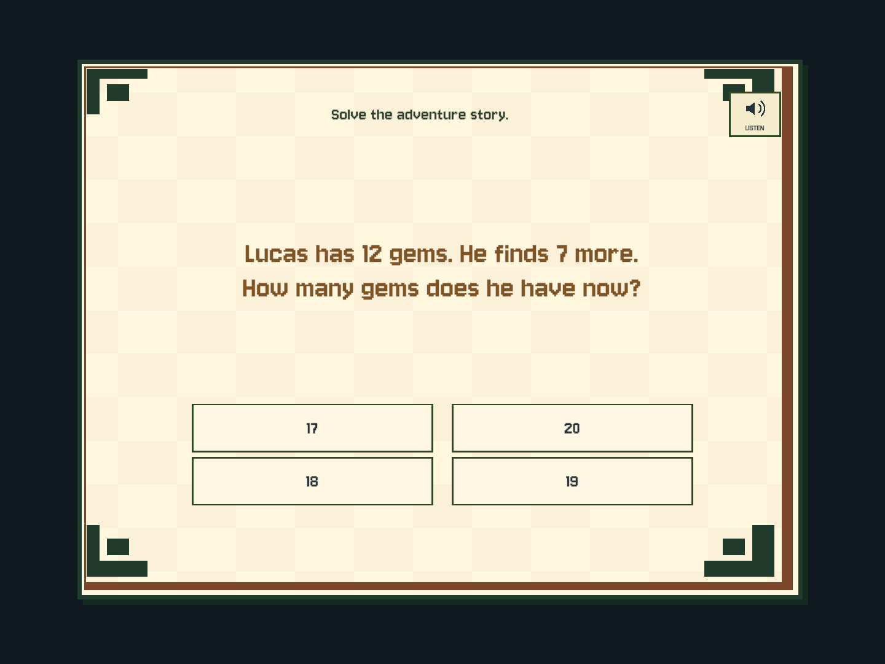
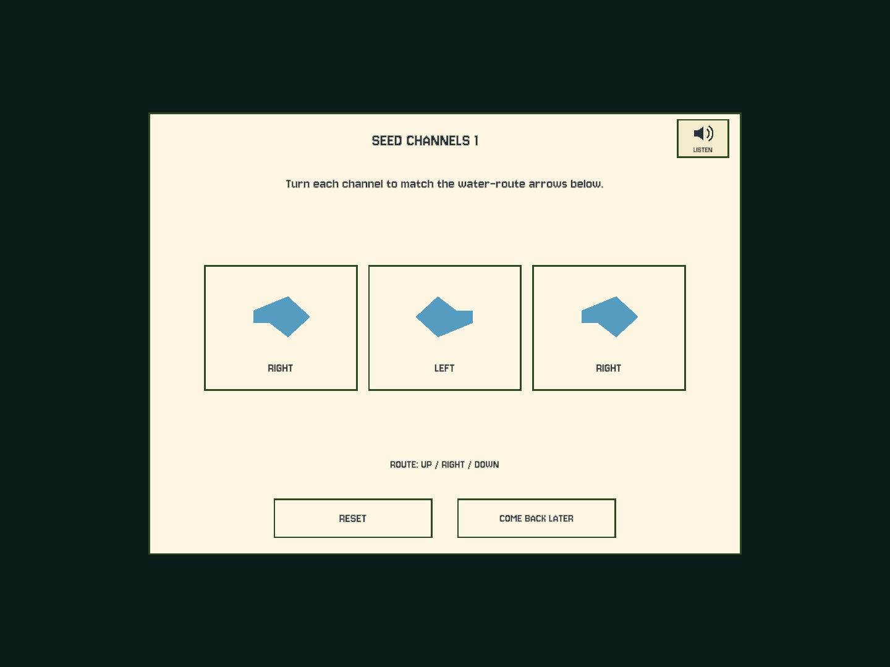

# 谜题可理解性审查与题目重听（2026-09-25）

## 结论与范围

用户提供的 Seed Channels 截图暴露的是**目标、操作和画面不一致**，不只是英语阅读能力问题。
本轮检查了全部八类扩展机关、K–5 题目生成/呈现/朗读路径，以及兼容数学 UI。
这是代码和界面审查，不代表已经完成儿童实测或正式课程认证。

**本轮已实现所有题目界面的重听按钮；下表的玩法重设计仍是待办，不应视为已经修复。**
功能开发阶段没有连接或安装 iPad，也没有读取、覆盖或迁移真实玩家存档。
后续已按用户要求随 **1.4.2 (8)** 原位安装，安装前后四文件逐字节一致，
见 [部署记录](ipad-1.4.2.md)；真机重听验收仍待确认。

## 八类扩展机关逐项审查

| 机关 / 地图 | 当前设计问题 | 建议改造 |
|---|---|---|
| Seed Channels / Verdant Vault | 三个箭头分别照抄底部方向文字，没有实际水渠、连通关系或水流。说明称“下方箭头”，实际目标是英文。箭头使用凹多边形扇形三角化，形状也失真。 | 优先：画出水源、种子与连续水渠；点击旋转后水沿连通段流动。目标用图示，首次演示一个转弯。低年级只需连接少量管段。 |
| Echo / Rime Gallery | 回声是常驻的数字串；铃铛无对应音高/闪光播放，操作只是抄数。错误后进度归零，缺少明确原因反馈。 | 优先：先播放短音阶和对应亮灯，提供重放；显示已正确完成的前缀。听觉与视觉必须都能完成，不把听力当门槛。 |
| Wind / Zephyr Gardens | 核心是避障走格，但角色显示 WIND 而不是说明中的 START；箭头始终朝右，不能表达实际移动方向，也不提示可走邻格。 | 保留可用的空间路径核心，标明起点/终点、高亮合法邻格并绘制轨迹；统一文案与移动规则。 |
| Sun Seals / Dusk Oasis | 点击会翻转自身和上下左右，但说明只说 neighbors，孩子无法判断是否包含斜角；无影响范围预览或入门示例。 | 点击前显示十字影响范围，先教一次操作；低年级从更小或一步可解的盘面开始，逐级扩大。 |
| Copper Relays / Resonant Foundry | 访问全部九格且不能重复，当前/已走状态只用 POWER / -- 表示；点起点会清空但原说明未提。三个阶段使用相同盘面，缺少递进。 | 优先：用亮起的电线表现连接、明确终点与已连接数量，加入撤销一步；阶段改变路径规模或障碍，而不是重复同题。 |
| Cooling Water / Ember Reservoir | 水从 1→2→3→1 单向流动，但没有管线或箭头，尤其第三杯回到第一杯很隐晦。三阶段只是各杯都加一滴，解法始终相同。 | 优先：画出传输方向和目标水位，逐滴动画；改变初始分配与有效策略。低年级用可数水滴，之后过渡到数量表示。 |
| Mosaic / Chronicle Archive | 本质是任意交换数字使 1–9 排序，并没有拼图画面；第一块被选中只加文字方括号。规则相对准确，但包装和操作反馈弱。 | 保留排序核心，给选中块明显边框/预览；如果称作 mosaic，就让完成后的图案真实组成一幅画。 |
| Moon Mirrors / Moonwell Depths | 右侧循环月相直到与左侧一致，没有镜像坐标、方向或对称关系。后期地图仍是简单照抄，三个阶段仅轮换目标。 | 优先：改成围绕水面/轴线补全位置和朝向的真实对称题；低年级一个缺口，高年级增加组合图形或多步规律。 |

共同问题：`DepthMechanism(kind, stage)` 完全不接收年级、难度或章节学习范围。
八类机关因此没有跟随 SYSTEM 的学习设置调整；“第三段机关”也不等于更难。
建议将机关的数学能力目标、年级边界、可见提示与具体盘面分开配置，再接入现有年级/难度系统。
机关成功后已经有地图揭示效果；缺的是**操作过程中**可理解的因果反馈，不是完全没有奖励。

代码依据：[机关状态与解法](../unity/Assets/Scripts/Core/DepthMechanism.cs)、
[机关界面](../unity/Assets/Scripts/Game/MapDepthUi.cs)、
[图形绘制](../unity/Assets/Scripts/Game/DepthMechanismGraphic.cs)。

## 常规数学题：还需要改进的地方

现有 K / Grade 1–5 混合题池分别为 17 / 19 / 18 / 20 / 22 / 24 个任务族。
覆盖运算、凑数、排序、规律、对称、图形、位值、时钟、分数、测量、图表、故事题等；
不能把所有题都归为“照抄”，时钟、分数、图表等确实提供了有意义的图示。

1. **全局阅读可访问性（本轮已处理）：** 以前只有首次自动朗读，没有随时重听入口。
   故事题尤其需要读完整情境，不能只重复 “Solve the adventure story” 这类标题。
2. **数字路径的错误反馈：** `LearningPuzzleUi.Submit` 把所有多选结果用 `+` 连接，排序题的正确顺序会被显示成加法。
   应按题型用路径箭头或逗号，只有凑数题使用加号。
3. **两次错误后的学习机会不足：** 显示答案后两秒自动离开，孩子未必读得完或听得懂。
   建议改为可重听的分步示例和明确的“继续”，不增加战斗惩罚。
4. **天平与数量脱节：** 当前天平主要是固定插画，数量在文字等式里，不对应盘上的具体物体。
   建议数量映射到砝码/方块，未知量用盒子表示，让“相等”能看懂，而不提前揭示答案。
5. **数水晶提示与交互不符：** 提示说逐个触碰水晶，但图形不能标记已数对象。
   建议点击后仅做计数标记，让孩子自己数，或修改提示避免承诺不存在的操作。
6. **故事题/货币题依赖文字：** 重听解决读不出的门槛，但不等于数量关系可视化。
   后续应加入与题意一致的可数对象/钱币；不是给每道题加一张无关装饰图。

代码依据：[新增题族与提示](../unity/Assets/Scripts/Core/LearningExpansion.cs)、
[数学界面与反馈](../unity/Assets/Scripts/Game/LearningPuzzleUi.cs)、
[保留视觉考点的朗读规则](../unity/Assets/Scripts/Core/LearningSpeech.cs)。

## 本轮实际完成：小喇叭 / LISTEN

- 战斗数学、地图探索/宝箱/进化等共用数学界面、兼容题型界面及八类扩展机关均有小喇叭。
- 点击从头重读当前题目的原始 statement；不重新生成题目，不提交答案，不清空已选对象。
- 故事等题目复用完整 `LearningSpeech.Lines`；视觉考题不会额外读出隐藏数量或答案。
- 机关读出必要的可见方向/回声顺序，并补充接电起点重置、第三杯倒回第一杯的操作说明。
- 连点会替换当前朗读，不叠加；主动 LISTEN 即使关闭自动朗读也可使用，不修改设置。
- 题目结束时按钮禁用，退出机关停止其语音；喇叭用几何绘制，不依赖 emoji 字体。
- 新增七段同一离线语音管线生成的音频；无需网络或在线语音服务。

## 验证、保存与回退

- Unity EditMode **223/223**，Node prototype **15/15** 通过。
- 新增八项回归测试：所有年级题族重听、错误后重读原题、多选保留、兼容题型、
  各年级/模式/章节抽样语音资源、24 个机关目标朗读、八机关入口、视觉考点不泄露。
- 生成 4:3 / 16:9 的故事、时钟、旧版规律、机关八张预览，并检查代表性布局。
  预览使用合成数据，不读取玩家存档。音频文件可用与调用路径已验证；真机声音与触控仍待验收。
- 存档格式仍为 v13；无版本升级、数值调整或真实进度写入。iPad 上 Lucas 最新存档始终为准。
- 本轮是一个独立提交；需要回退时对该提交使用 `git revert <commit>`，不要恢复旧存档。
  下一次安装必须重新备份当时的 iPad 存档，同 bundle 原位更新，不卸载。

建议下一轮先重做水渠、回声、倒水三个最容易让孩子不理解操作的机关，
同时修正数字路径答案分隔符；之后处理接电/日月机关的教学与年级递进。
