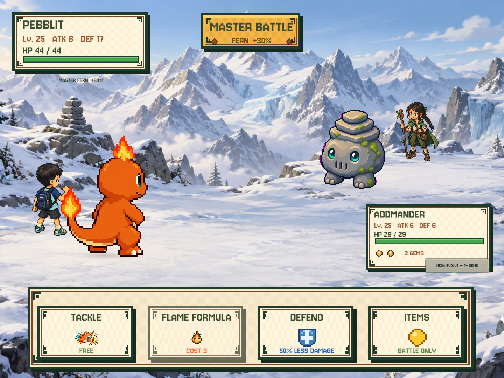
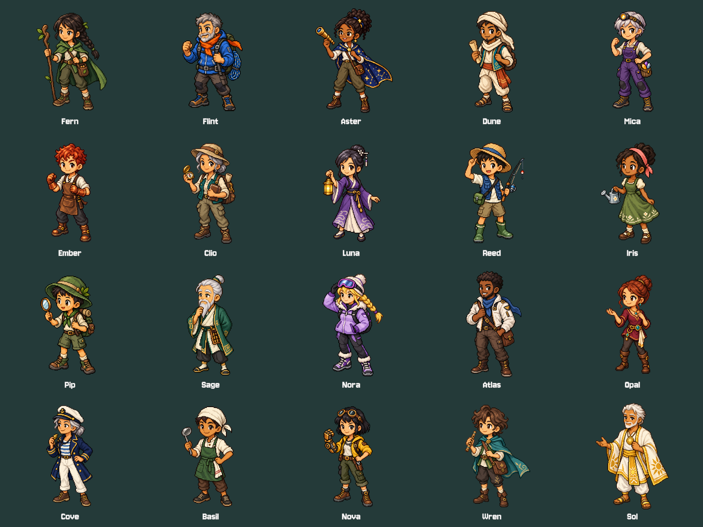

# Training, roster safety and grade-based math — 2026-09-21

Local development only. This update has **not** been built for or installed on Lucas's iPad.
The device remains the authoritative save. Do not uninstall, reset, or import an older Mac save.

## Battle

- Lucas now stands behind his partner, using a dedicated rear three-quarter battle sprite.
- 20% of otherwise eligible random wild encounters become Master battles. The same map's rolled
  creature, level and variation are retained, then HP, ATK, DEF and XP are multiplied by a randomly
  chosen 1.20–1.40. Integer stats round to the nearest integer, so tiny stats cannot express an exact
  percentage. The wild template is cloned, not mutated. Bosses and merchant battles are unchanged.
- Masters use twenty original transparent trainer portraits. Their partners cannot be caught;
  the battle banner names the trainer and displays the nominal bonus.
- **Defend** consumes one action without a gem cost. The next enemy attack deals `ceil(damage / 2)`
  after normal ATK/DEF/variance. Guard does not stack, cannot carry across player turns, and expires
  even if the enemy is stunned. Existing Mega turn upkeep still applies.
- Tackle has a new physical-impact icon. Wild battles show five command buttons; Master battles
  omit Catch. Grounded placement is checked at 4:3 and 16:9.

## Team and inventory

- Sort by **TYPE / NEW / LEVEL / DEF / ATK**. TYPE groups elemental type, then form name. Stat sorts
  include growth, captured-stat offsets and equipped bonuses. NEW reverses acquisition order;
  sorting never rewrites that history or changes the active partner.
- Let Go requires choosing the reward, then a separate final confirmation naming the creature,
  level, reward and irreversible removal. The final button waits 0.8 seconds to prevent tap-through.
  Addmander remains protected; gear returns to inventory.
- Every equipment slot opens the complete owned-item list, including items on other partners.
  Rows show both bonuses and current owner. A separate confirmation transfers an occupied item.
  Choosing an occupied destination slot replaces that item atomically; the displaced item becomes
  available. Stale owner, unknown target and capacity failures leave both owners unchanged.

## Math: grade × mode × chapter

SYSTEM has a six-position **Kindergarten / Grade 1–5** slider. Each grade remembers its own mode:
Normal, Feel Good, Challenging or Random. Default for new and migrated saves is Kindergarten / Normal.
Settings persist in the active save, not across unrelated save slots.

The current map's chapter (1–8) linearly interpolates numerical limits and selected complexity
parameters **inside the selected grade and mode**, rounded where necessary. Later chapters do not
automatically select a higher grade. Random chooses one of the three modes for each question,
within that same grade and chapter. Randomly drawn individual questions can still be easier than
the preceding one; the progression describes their allowed difficulty envelope, not every sample.

| Grade | Content available |
|---|---|
| K | Add/subtract within 10, missing numbers, comparison, counting/chart reading, teen-number composition, shape sides, symmetry, repeating patterns, relative length |
| 1 | Add/subtract within 20, tens/ones, hour/half-hour clocks, half/quarter diagrams, measured-length differences, three-category data |
| 2 | Add/subtract within 100, hundreds, five-minute clocks, missing sequence positions, multi-step review, lengths/data |
| 3 | Add/subtract within 1,000, multiplication/division facts within 100, fraction diagrams, elapsed time, perimeter/area |
| 4 | Multi-digit arithmetic, multiplication/division, like-denominator fraction addition, place value, perimeter/area and missing dimensions |
| 5 | Decimal arithmetic/comparison, parenthesized decimal expressions, fraction addition using common denominators, elapsed time and volume |

For example, **Grade 1 / Normal** arithmetic limits across the eight chapters are
`10, 11, 13, 14, 16, 17, 19, 20`. K Normal moves from 5 to 10; Feel Good uses 4–5 in K and
5–10 in Grade 1. Challenging keeps the grade ceiling while adding unknown operands, missing
middle terms and multi-step problems where appropriate. Place-value tasks have their own
grade-appropriate bounds (e.g. K teens); an arithmetic cap is not a ban on reading larger numbers.

Five new puzzle families: **place value, time, fractions, measurement, and data**. K never receives
time or fractions. Existing visual pattern/symmetry interactions remain. Treasure puzzles mix the
grade-appropriate pool; themed story interactions retain their requested family; 25% of skill
puzzles mix the pool to expose the new families. All runtime entry points receive the same settings
and map chapter. The legacy, settings-free generators remain available to old tests/tools only.

Teaching diagrams are code-drawn so clock hands, equal fraction partitions and bars are exact.
Wrong answers reveal a hint and allow a retry; Feel Good shows the hint immediately. No new timer
or damage penalty is introduced. Integer equations and numeric patterns still feed spell visuals;
decimal/multi-step spells display the solved expression without spawning huge particle counts.

The grade grouping takes guidance from [Common Core OA](https://www.thecorestandards.org/Math/Content/OA/),
[base-ten progression](https://www.thecorestandards.org/Math/Content/NBT/) and the
[complete mathematics standards](https://corestandards.org/wp-content/uploads/2023/09/ADA-Compliant-Math-Standards.pdf).
This is a curated practice set, **not a complete or certified K–5 curriculum**. Early fraction notation
is a visual equal-sharing introduction, not formal fraction arithmetic.

## Art, audio and verification

Twenty trainer PNGs, Lucas's battle sprite and Tackle were individually generated with imagegen using
the existing Lucas portrait as a style reference. No existing creature art was replaced.
[Prompts and provenance](training-art-manifest.json) are retained. Import sizes are bounded to 512px
for trainers/Lucas and 256px for Tackle; original source PNGs remain intact.

New narration uses offline macOS Samantha clips and composable number/operator tokens, avoiding
thousands of prerecorded numerical permutations. Rebuild the finite voice manifest with
`Numeria.Editor.LearningPreview.ExportSpeech`, then `zsh tools/bake-voice.sh --learning-only`.
The preview exporter uses fresh data and never loads/saves player slots.

Verification: **177/177 Unity EditMode tests; 15/15 Node prototype tests**. Tests include 74,240
generated grade/mode/chapter questions and 57,600 independently evaluated equations/patterns,
guard rounding/expiry, encounter rates/stat cloning, roster ordering, atomic gear transfer, release
tap protection, settings persistence, v11 migration, alpha/resource availability and spoken clips.
Rendered previews cover trainer/wild battle, System, team, protected dialogs and all five new families.
Physical iPad touch, performance, audio listening and end-to-end playtesting remain pending.

## Save and rollback safety

Save schema is **v12**: only learning settings and sort preference are added; captured combat stats,
levels, items, coins, world progress and slot identities are preserved. v11 and older builds must not
be used to overwrite a migrated v12 save. A Git revert rolls back code, **not** already migrated saves.
Before eventual device installation: take a fresh backup of iPad Documents, install in place with
the same bundle ID/team, compare saves before launch, and retain both pre/post-update backups.
No current save backup is embedded in this build or feature commit.
